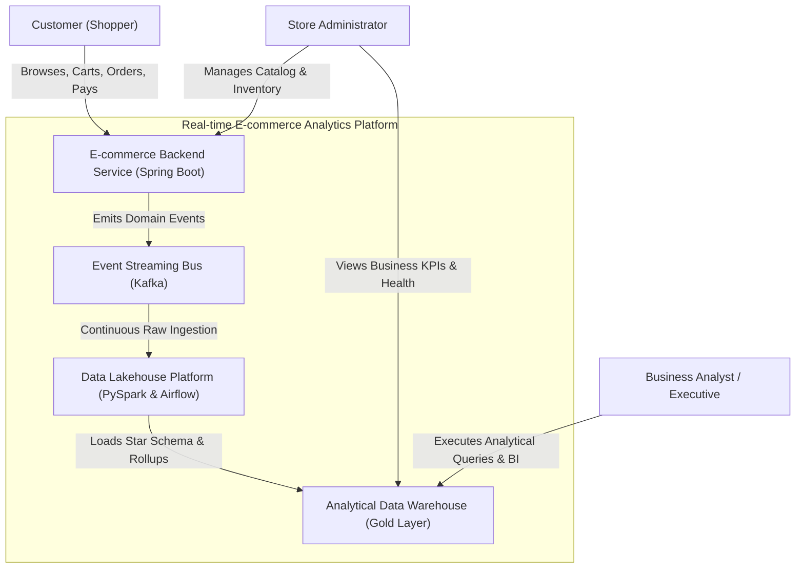
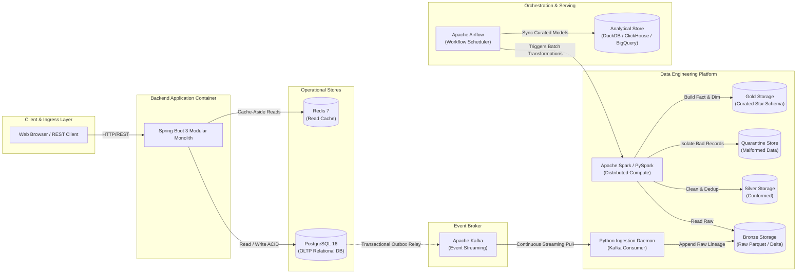
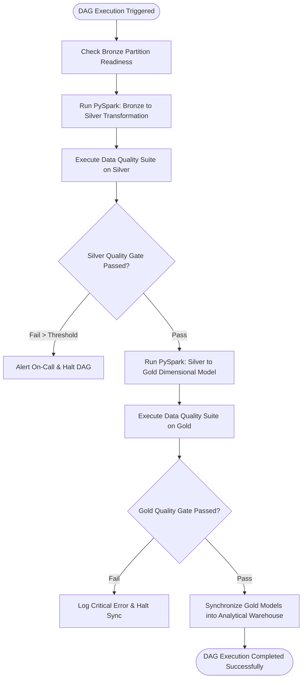
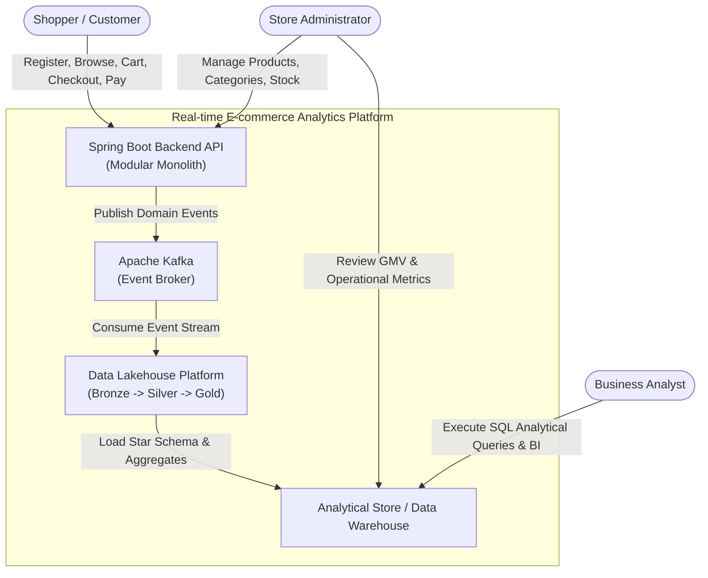
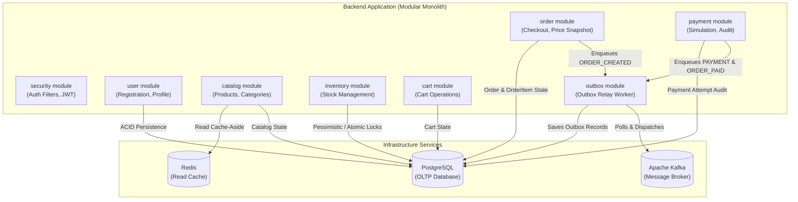
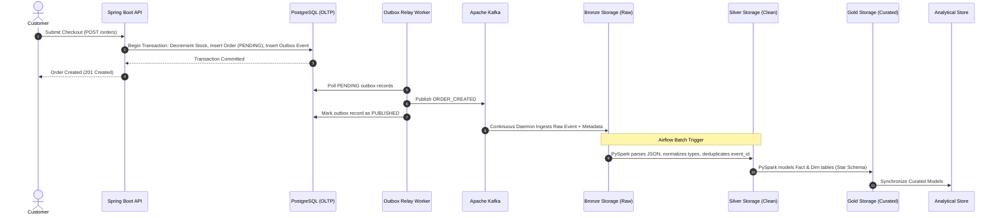
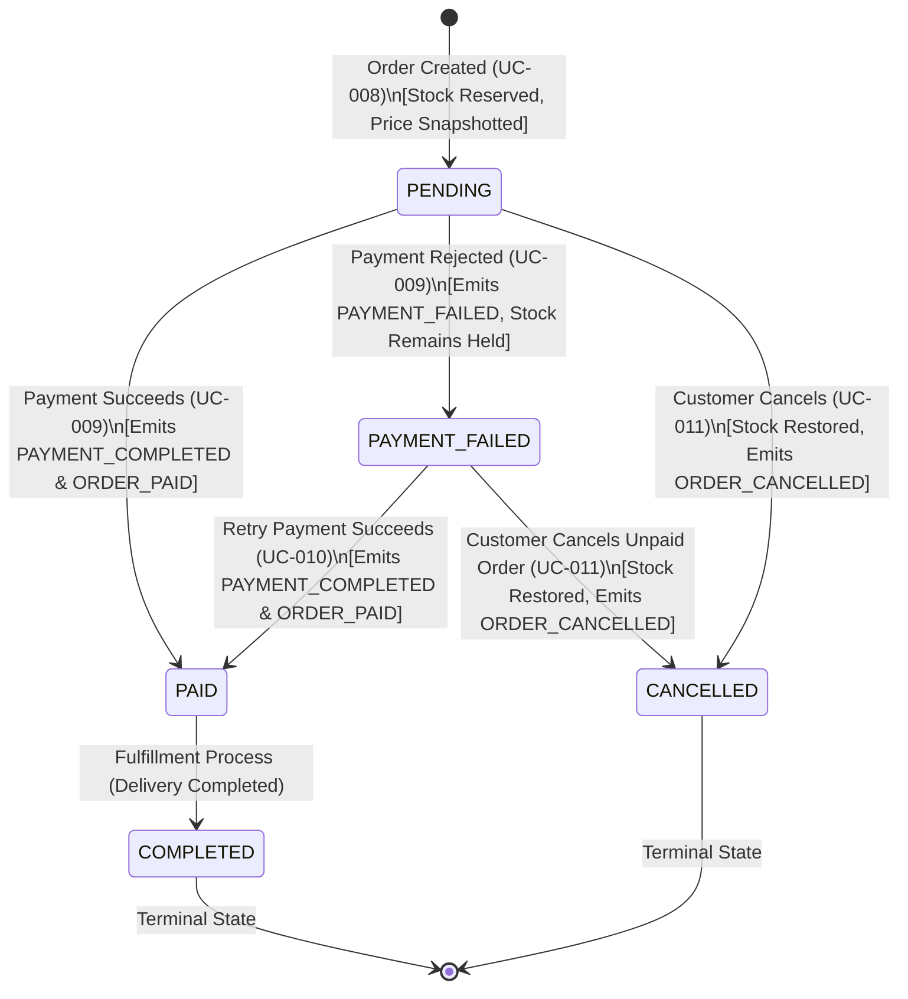
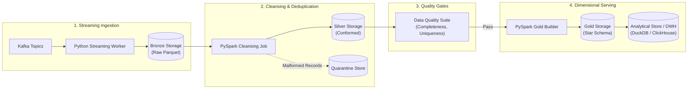

# Real-time E-commerce Analytics Platform
## System Architecture Specification

---

## 1. Architecture Overview

### 1.1 Executive Summary
The **Real-time E-commerce Analytics Platform** is designed to demonstrate end-to-end engineering excellence across two complementary domains: **Transactional Backend Engineering (~35%)** and **Data Platform Engineering (~65%)**. 

The system bridges high-throughput transactional e-commerce operations (OLTP) with low-latency, scalable analytical intelligence (OLAP). Rather than coupling analytics queries to the operational database, the architecture enforces an **Event-Driven Architecture (EDA)** where operational state changes are published as durable domain events to **Apache Kafka**. A decoupled, multi-tier data platform ingests these events into a **Medallion Lakehouse Architecture (Bronze $\rightarrow$ Silver $\rightarrow$ Gold)**, orchestrates batch transformations and quality assertions via **Apache Airflow**, and serves analytical queries via a dedicated **Analytical Store**.

```
+---------------------------------------------------------------------------------------------------------+
|                                        SYSTEM TOPOLOGY OVERVIEW                                         |
+---------------------------------------------------------------------------------------------------------+
|                                                                                                         |
|   [ Customers & Admins ]                                                                                |
|             │                                                                                           |
|             ▼                                                                                           |
|   ┌──────────────────────────────────────────────────────────┐                                          |
|   │         E-Commerce Backend (Spring Boot Monolith)        │                                          |
|   │  ┌──────────┐ ┌──────────┐ ┌──────┐ ┌───────┐ ┌────────┐ │                                          |
|   │  │ Catalog  │ │Inventory │ │ Cart │ │ Order │ │Payment │ │                                          |
|   │  └────┬─────┘ └────┬─────┘ └───┬──┘ └───┬───┘ └───┬────┘ │                                          |
|   └───────┼────────────┼───────────┼────────┼─────────┼──────┘                                          |
|           │            │           │        │         │                                                 |
|           ▼            └───────────┼────────┼─────────┘                                                 |
|     ┌───────────┐                  ▼        ▼                                                           |
|     │   Redis   │            ┌────────────────────────┐                                                 |
|     │ (Read-Opt)│            │ PostgreSQL (OLTP DB)   │                                                 |
|     └───────────┘            │  - Business Tables     │                                                 |
|                              │  - Transactional Outbox│                                                 |
|                              └───────────┬────────────┘                                                 |
|                                          │                                                              |
|                                          ▼ (Reliable Relay)                                             |
|                              ┌────────────────────────┐                                                 |
|                              │      Apache Kafka      │ <── Exclusive Decoupled Analytics Transport     |
|                              └───────────┬────────────┘                                                 |
|                                          │                                                              |
|                     ┌────────────────────┴────────────────────┐                                         |
|                     ▼ (Continuous Streaming Consumer)         │                                         |
|         ┌───────────────────────┐                             │                                         |
|         │  Bronze Storage (Raw) │ <───────────────────────────┘                                         |
|         └───────────┬───────────┘                                                                       |
|                     │                                                                                   |
|                     ▼ (PySpark Transformation & Deduplication)                                          |
|         ┌───────────────────────┐    ┌─────────────────────────┐                                        |
|         │ Silver Storage (Clean)│ ──►│ Quarantine Store (Dead) │                                        |
|         └───────────┬───────────┘    └─────────────────────────┘                                        |
|                     │                                                                                   |
|                     ▼ (PySpark Star Schema & Aggregations)                                              |
|         ┌───────────────────────┐                                                                       |
|         │  Gold Storage (Curated│                                                                       |
|         └───────────┬───────────┘                                                                       |
|                     │                                                                                   |
|                     ▼ (Warehouse Load)                                                                  |
|         ┌───────────────────────┐                                                                       |
|         │   Analytical Store    │ ◄── [ Airflow Orchestrator manages Silver -> Gold -> Serving ]        |
|         └───────────┬───────────┘                                                                       |
|                     │                                                                                   |
|                     ▼                                                                                   |
|         [ Business Intelligence ]                                                                       |
|                                                                                                         |
+---------------------------------------------------------------------------------------------------------+
```

### 1.2 Architectural Objectives & Constraints
1. **Strict OLTP/OLAP Decoupling:** Under zero circumstances do analytical queries or data pipelines connect directly to the operational PostgreSQL database. All analytical data is derived from the event stream.
2. **Deterministic State Machine:** Business transitions follow strict invariants:
   $$\text{PENDING} \longrightarrow \{\text{PAID}, \text{PAYMENT\_FAILED}, \text{CANCELLED}\}$$
   $$\text{PAYMENT\_FAILED} \longrightarrow \{\text{PAID}, \text{CANCELLED}\}$$
   $$\text{PAID} \longrightarrow \{\text{COMPLETED}\}$$
3. **Dual-Role Portfolio Alignment:** The design provides deep architectural evidence for both Backend (Modular Monolith, DDD, SOLID, Outbox pattern, ACID transactions) and Data Engineering (Lakehouse Medallion, PySpark distributed compute, Star Schema modeling, Airflow DAG orchestration, Idempotency).
4. **Local Workstation Feasibility:** The full architecture runs deterministically within a **16 GB RAM** envelope using Docker Compose.

---

## 2. Architecture Principles

1. **PostgreSQL as the Sole Operational Source of Truth:** Transactional state (users, catalog, inventory, carts, orders, payments) is authored exclusively in PostgreSQL with ACID guarantees.
2. **Decoupled Analytical Transport:** Apache Kafka acts as the unyielding isolation boundary between operational transaction processing and downstream analytics.
3. **Zero Analytical Queries on OLTP:** Analytical reporting queries are strictly forbidden from targeting operational PostgreSQL to eliminate connection starvation and locking contention.
4. **Bronze Layer Invariant (Lineage & Replay):** The Bronze layer stores raw, verbatim payloads with transport metadata. It is append-only, immutable, and supports full analytical recomputation from inception.
5. **Silver Layer Conformance & Deduplication:** The Silver layer normalizes schemas, enforces strict typing, isolates corrupt payloads to quarantine, and guarantees idempotent deduplication across network retries.
6. **Gold Layer Dimensional Serving:** Business intelligence is served exclusively from Star Schema dimensional models (Fact and Dimension tables) and pre-aggregated rollups in the Gold tier.
7. **Idempotency Across Every Tier:** Re-running pipelines, reprocessing partitions, or receiving duplicate events must never inflate financial metrics or corrupt persisted states.
8. **Reliable Event Publication:** Business transactions and event emissions must remain transactionally consistent; broker latency or downtime must never abort committed operational transactions.
9. **High Cohesion, Low Coupling (Modular Monolith):** The backend is partitioned into strictly bounded modules with unidirectional dependencies, preventing cyclic entanglement without microservice network overhead.
10. **Separation of Concerns:** Pure business logic is shielded from infrastructure details (database drivers, Kafka producers, cache clients) using dependency inversion.
11. **Pragmatic Technology Choices:** Technologies are selected exclusively based on stated requirements; distributed complexity (e.g., Flink, Kubernetes) is rejected in favor of local reproducibility.
12. **End-to-End Observability:** Every transaction, event, and pipeline execution maintains structured logging, correlation IDs, and quality metrics across the lifecycle.

---

## 3. System Context & Top-Level Architecture

### 3.1 Context Diagram (C4 Level 1)


### 3.2 Container Architecture (C4 Level 2)


---

## 4. Backend Architecture (Modular Monolith)

The backend is engineered as a **Modular Monolith** in Java 17/21 and Spring Boot 3. It groups cohesive business capabilities into strictly bounded domain modules while executing within a single deployment unit to maximize local developer productivity and testability.

### 4.1 Module Decomposition & Responsibilities

| Module Name | Core Responsibilities | Inbound Dependencies Allowed |
| :--- | :--- | :--- |
| **`common`** | Shared value objects, base exceptions, pagination contracts, correlation context. | None (Base module). |
| **`security`** | Stateless authentication filters, token validation, password hashing contracts. | `user`, `common` |
| **`user`** | Customer registration, profile retrieval, credential verification, `USER_REGISTERED` event. | `common` |
| **`catalog`** | Categories, products, price management, read-cache integration, `PRODUCT_VIEWED` event. | `common` |
| **`inventory`** | Stock levels, inventory decrement on order, inventory restoration on cancellation. | `catalog`, `common` |
| **`cart`** | In-flight shopping cart state, item additions, quantity updates, total derivations. | `catalog`, `inventory`, `common` |
| **`order`** | Order placement, historical price snapshotting, state machine, `ORDER_CREATED`, `ORDER_CANCELLED`. | `cart`, `inventory`, `user`, `common` |
| **`payment`** | Deterministic payment simulation, settlement audit trail, `PAYMENT_COMPLETED`, `ORDER_PAID`. | `order`, `common` |
| **`outbox`** | Transactional outbox persistence, polling/relay publisher to Apache Kafka. | `common` |

```
                       ┌──────────────┐
                       │    common    │
                       └──────▲───────┘
                              │
             ┌────────────────┼────────────────┐
             │                │                │
      ┌──────┴──────┐  ┌──────┴──────┐  ┌──────┴──────┐
      │    user     │  │   catalog   │  │   outbox    │
      └──────▲──────┘  └──────▲──────┘  └──────▲──────┘
             │                │                │
      ┌──────┴──────┐  ┌──────┴──────┐         │
      │  security   │  │  inventory  │         │
      └─────────────┘  └──────▲──────┘         │
                              │                │
                       ┌──────┴──────┐         │
                       │    cart     │         │
                       └──────▲──────┘         │
                              │                │
                       ┌──────┴──────┐         │
                       │    order    │─────────┤ (Enqueues Events)
                       └──────▲──────┘         │
                              │                │
                       ┌──────┴──────┐         │
                       │   payment   │─────────┘
                       └─────────────┘
```

### 4.2 Module Dependency Invariants
- **Unidirectional Flow:** Higher-level workflow modules (`order`, `payment`) depend on foundational domain modules (`inventory`, `catalog`), never the reverse.
- **Strictly No Circular Dependencies:** `order` communicates with `inventory` to reserve stock; `inventory` never imports or references `order` types.
- **Event-Driven Decoupling:** When a payment succeeds, the `payment` module mutates order status via explicit order service interfaces and records domain events to `outbox`. Downstream components listen to Kafka rather than coupling via in-memory cross-module calls.

### 4.3 Clean Layered Structure within Modules
Each domain module adheres internally to hexagonal / clean architecture conventions:

```
module-root (e.g., com.ecommerce.order)
├── domain/                  <-- Core Business Logic & Invariants (Framework Independent)
│   ├── model/               <-- Entities, Aggregates, Value Objects, OrderStatus Enum
│   ├── repository/          <-- Repository SPI Interfaces (Domain Ports)
│   └── exception/           <-- Domain-specific business rule exceptions
├── application/             <-- Use Case Orchestration & DTOs
│   ├── service/             <-- Application Service implementations
│   ├── dto/                 <-- Request/Response Data Transfer Objects
│   └── port/                <-- Inbound Ports / Command interfaces
└── infrastructure/          <-- Framework & Technical Adapters
    ├── persistence/         <-- Spring Data JPA Repositories, Database Entities, Mappers
    ├── web/                 <-- Spring MVC REST Controllers, Validation Handlers
    └── adapter/             <-- Module-specific outgoing adapters
```

---

## 5. Database Architecture (PostgreSQL OLTP)

PostgreSQL 16 serves as the single source of truth for transactional e-commerce state.

### 5.1 Relational Schema Topology
The transactional relational database comprises 9 core business tables and 1 infrastructural table:

1. **`users`:** Customer identity, unique email/username, salted password hash, account status, audit timestamps.
2. **`categories`:** Category taxonomy, slug, name, parent category reference.
3. **`products`:** SKU, title, description, base unit price, active flag, category ID.
4. **`inventory`:** Product ID foreign key, available stock quantity, reserved stock quantity, version/lock field.
5. **`carts`:** Customer/guest session identifier, creation and last-updated timestamps.
6. **`cart_items`:** Cart ID, product ID, selected quantity, added timestamp.
7. **`orders`:** Order ID (UUID), customer ID, status (`PENDING`, `PAID`, `PAYMENT_FAILED`, `CANCELLED`, `COMPLETED`), subtotal, tax, shipping, total amount, order timestamp.
8. **`order_items`:** Line item ID, order ID, product ID, historical snapshot title, historical snapshot unit price, quantity, line total.
9. **`payments`:** Payment transaction ID (UUID), order ID, attempt count, settlement status (`SUCCESS`, `FAILED`), error code, payment method, amount, timestamp.
10. **`outbox_events`:** Event UUID, aggregate type (`ORDER`, `PAYMENT`), aggregate ID, event type, payload (JSON), status (`PENDING`, `PUBLISHED`, `FAILED`), retry count, created timestamp, published timestamp.

### 5.2 Transactional Boundaries & Concurrency Control
- **Order Placement Transaction Boundary (`UC-008`):**
  - Executed inside a single `@Transactional` ACID boundary with `READ_COMMITTED` isolation.
  - Step 1: Validate active cart and fetch items.
  - Step 2: Acquire pessimistic write lock (`SELECT ... FOR UPDATE`) or apply atomic conditional decrement on `inventory` row:
    $$\text{UPDATE inventory SET available = available - } q \text{ WHERE product\_id = } id \text{ AND available } \ge q;$$
    If affected rows $= 0$, throw `InsufficientStockException` and rollback transaction.
  - Step 3: Insert `orders` record with status `PENDING`.
  - Step 4: Insert `order_items` rows locking snapshot unit prices.
  - Step 5: Delete cart items.
  - Step 6: Insert `ORDER_CREATED` event record into `outbox_events`.
  - Step 7: Commit transaction.

- **Inventory Restoration Boundary (`UC-011`):**
  - When an order transitions to `CANCELLED`, an atomic transaction executes:
    $$\text{UPDATE inventory SET available = available + } q \text{ WHERE product\_id = } id;$$
  - Inserts `ORDER_CANCELLED` into `outbox_events`.
  - Commits transaction.

---

## 6. Cache Architecture (Redis)

Redis 7 functions strictly as an ephemeral, read-optimization cache layer. It is **never** a system of record.

### 6.1 Cache-Aside Pattern
```
Client Request
      │
      ▼
Backend Service
      │
      ├── 1. Check Key ──────────────► Redis Cache
      │                                    │
      │◄── 2. Cache Hit (Return DTO) ──────┤
      │                                    │
      ├── 3. Cache Miss (Fallback)         │
      │        │                           │
      │        ▼                           │
      │   PostgreSQL                       │
      │        │                           │
      │        ▼                           │
      ├── 4. Populate Cache (with TTL) ───►│
      │
      ▼
Return Client Response
```

### 6.2 Key Namespace & Invalidation Strategy
- **Catalog Browsing Keys:** `catalog:products:page:{page}:size:{size}:cat:{categoryId}` (TTL: 10 minutes).
- **Product Detail Keys:** `catalog:product:{productId}` (TTL: 30 minutes).
- **Invalidation Strategy:** Whenever `UC-ADMIN-001` or `UC-ADMIN-003` modifies a product or restocks inventory:
  1. Transaction updates PostgreSQL.
  2. Redis key `catalog:product:{productId}` is evicted immediately (`DEL`).
  3. General catalog page cache keys are evicted via pattern matching or allowed to expire naturally via short TTLs to maintain consistency without cascading cache locks.
- **Cache Resilience:** If Redis suffers total connectivity loss, the backend logs a warning, bypasses the cache transparently, and serves queries directly from PostgreSQL without failing user requests.

---

## 7. Event Streaming Architecture (Apache Kafka)

Apache Kafka acts as the decoupled messaging backbone connecting transactional operations with the data platform.

### 7.1 Event Envelope Contract
Every event published to Kafka conforms to an immutable, standardized envelope:

```json
{
  "event_id": "c6a2b8e4-18c7-4389-8d5b-f1d752c0384a",
  "event_type": "ORDER_CREATED",
  "event_timestamp": "2026-09-25T15:30:00.123456Z",
  "producer": "ecommerce-backend",
  "schema_version": "1.0",
  "aggregate_type": "ORDER",
  "aggregate_id": "ord-90214",
  "payload": {
    "order_id": "ord-90214",
    "customer_id": "usr-55102",
    "status": "PENDING",
    "total_amount": 1299.99,
    "currency": "USD",
    "items": [
      {
        "product_id": "prod-101",
        "sku": "LAPTOP-PRO-15",
        "title": "Ultra Laptop 15",
        "unit_price": 1299.99,
        "quantity": 1,
        "line_total": 1299.99
      }
    ]
  }
}
```

### 7.2 Event Catalog & Business Semantics

| Event Type | Aggregate Type | Partition Key Strategy | Core Business Semantic |
| :--- | :--- | :--- | :--- |
| **`USER_REGISTERED`** | `USER` | `customer_id` | Account created; feeds customer acquisition cohort models. |
| **`PRODUCT_VIEWED`** | `PRODUCT` | `product_id` | Product detail viewed; telemetry feeds browse-to-buy funnel. |
| **`CART_UPDATED`** | `CART` | `customer_id` or `cart_id` | Cart items modified; feeds cart abandonment metrics. |
| **`ORDER_CREATED`** | `ORDER` | `order_id` | Order placed in `PENDING` status; stock reserved. |
| **`PAYMENT_COMPLETED`** | `PAYMENT` | `order_id` | Financial settlement attempt **succeeded**; audit trail in `fact_payments`. |
| **`PAYMENT_FAILED`** | `PAYMENT` | `order_id` | Financial settlement attempt **failed**; feeds failure rate analytics. |
| **`ORDER_PAID`** | `ORDER` | `order_id` | Order state officially transitions to `PAID`. **Sole authoritative event for GMV recognition**. |
| **`ORDER_CANCELLED`** | `ORDER` | `order_id` | Order cancelled; stock restored; revenue strictly excluded from GMV. |

> [!IMPORTANT]
> **Strict Semantic Boundary (`PAYMENT_COMPLETED` vs. `ORDER_PAID`):**
> A customer retrying a failed payment may produce multiple `PAYMENT_FAILED` events followed by one `PAYMENT_COMPLETED` event. Downstream financial reconciliation parses all payment events. However, the data warehouse fact table `fact_orders` attributes revenue **only upon consumption of `ORDER_PAID`**. This eliminates double-counting revenue while preserving complete transaction history.

### 7.3 Topic Partitioning & Ordering Strategy
- **Partitioning Key:** All order and payment lifecycle events (`ORDER_CREATED`, `PAYMENT_COMPLETED`, `PAYMENT_FAILED`, `ORDER_PAID`, `ORDER_CANCELLED`) use `order_id` as their Kafka message key.
- **Ordering Guarantee:** In Kafka, messages sharing identical keys are routed deterministically to the same partition. This guarantees strict per-order chronological ordering (e.g., `ORDER_CREATED` $\rightarrow$ `PAYMENT_FAILED` $\rightarrow$ `ORDER_PAID`), ensuring downstream PySpark deduplication and state aggregation logic never encounters out-of-order state corruptions.

---

## 8. Event Publishing Reliability (Transactional Outbox Pattern)

### 8.1 Reliability Architecture Trade-off Analysis
To satisfy `ER-004` and `DRIR-001`, three publishing models were evaluated:

1. **Option A: Direct Asynchronous Dispatch (Spring `@Async` KafkaTemplate):**
   - *Flaw:* If Kafka is temporarily unreachable or the container restarts right after the database commits, the event is permanently lost, causing catastrophic silent data loss between OLTP and OLAP.
2. **Option B: Distributed 2-Phase Commit (XA Transactions):**
   - *Flaw:* Highly complex, requires Kafka XA drivers, creates tight coupling, and severely degrades throughput.
3. **Option C: Transactional Outbox Pattern (Selected):**
   - *Advantage:* Zero distributed transactions. Events are persisted to an `outbox_events` table inside the *exact same local database transaction* as the domain entity update. An independent asynchronous relay worker reads pending outbox records and publishes them to Kafka with retries.

```
       CLIENT REQUEST
             │
             ▼
   [ Spring Boot Service ]
             │
             ├── 1. BEGIN DB TRANSACTION ────────┐
             │   ├── UPDATE orders               │
             │   ├── UPDATE inventory            │
             │   └── INSERT outbox_events        │
             ├── 2. COMMIT TRANSACTION ◄────────┘ (Guaranteed Atomic)
             │
     (Response to User)
             │
             ▼
   [ Outbox Publisher Relay ] ◄── (Background Poller / Debezium)
             │
             ├── 3. Read PENDING Outbox Records
             ├── 4. Publish to Kafka Broker ─────► [ Apache Kafka ]
             └── 5. Mark Outbox as PUBLISHED
```

### 8.2 Outbox Publisher Mechanism
- A scheduled Spring background worker (`@Scheduled(fixedDelay = 500ms)`) queries unhandled outbox records using `SELECT ... FOR UPDATE SKIP LOCKED` in batches of 100.
- Successfully published messages are marked `PUBLISHED` with timestamps.
- If Kafka is unreachable, the outbox records remain safely persisted in PostgreSQL; the worker retries with exponential backoff without impacting ongoing customer checkout operations.

---

## 9. Data Engineering Architecture (Medallion Lakehouse)

The data engineering ecosystem processes streaming business events into structured, business-ready dimensional models using a three-tier **Medallion Lakehouse Architecture**.

```
                  ┌──────────────────────────────────────────────┐
                  │          Kafka Topics (Event Bus)            │
                  └──────────────────────┬───────────────────────┘
                                         │
                                         ▼ (Continuous Ingestion Daemon)
+─────────────────────────────────────────────────────────────────────────────────────────────+
| BRONZE TIER (Raw Lakehouse - Immutable Append-Only Storage)                                 |
|                                                                                             |
| Filesystem / MinIO: /data/bronze/{topic}/year={yyyy}/month={mm}/day={dd}/hour={hh}/*.parquet|
| Schema:                                                                                     |
|   ├── raw_payload (STRING / JSON)                                                           |
|   ├── event_id (STRING)                                                                     |
|   ├── event_type (STRING)                                                                   |
|   ├── ingestion_timestamp (TIMESTAMP UTC)                                                   |
|   ├── source_topic (STRING)                                                                 |
|   ├── kafka_partition (INTEGER)                                                             |
|   └── kafka_offset (BIGINT)                                                                 |
+─────────────────────────────────────────────────────────────────────────────────────────────+
                                         │
                                         ▼ (PySpark Transformation Batch - Triggered by Airflow)
+─────────────────────────────────────────────────────────────────────────────────────────────+
| SILVER TIER (Cleansed & Conformed Delta / Parquet Storage)                                  |
|                                                                                             |
| Datasets:                                                                                   |
|   ├── silver_orders (order_id, customer_id, status, subtotal, tax, total, created_at)       |
|   ├── silver_order_items (line_id, order_id, product_id, title, unit_price, quantity, total)|
|   ├── silver_payments (payment_id, order_id, status, amount, method, timestamp)             |
|   └── silver_product_views (view_id, product_id, category_id, viewer_id, price, timestamp)  |
|                                                                                             |
| Processing Logic:                                                                           |
|   1. JSON schema parse & strict type casting (Decimal, Timestamp).                          |
|   2. Deduplication via window functions: ROW_NUMBER() OVER (PARTITION BY event_id ORDER BY) |
|   3. Invalid / corrupt record routing into /data/quarantine/*                               |
+─────────────────────────────────────────────────────────────────────────────────────────────+
                                         │
                                         ▼ (PySpark Star Schema Modeling & Aggregation)
+─────────────────────────────────────────────────────────────────────────────────────────────+
| GOLD TIER (Curated Dimensional Models - Star Schema & Analytical Serving)                   |
|                                                                                             |
| Dimension Tables:                      Fact Tables:                                         |
|   ├── dim_customers                      ├── fact_orders (GMV recognized on ORDER_PAID)     |
|   ├── dim_products                       ├── fact_order_items                               |
|   ├── dim_categories                     ├── fact_payments                                  |
|   ├── dim_date                           └── fact_product_views                             |
|   └── dim_order_status                                                                      |
|                                                                                             |
| Summary Aggregate Rollups:                                                                  |
|   ├── agg_daily_sales (date_key, total_revenue, order_count, paid_orders, aov)              |
|   ├── agg_category_performance (category_key, date_key, gross_revenue, units_sold)          |
|   └── agg_product_conversion (product_key, date_key, view_count, cart_count, purchase_count)|
+─────────────────────────────────────────────────────────────────────────────────────────────+
                                         │
                                         ▼
+─────────────────────────────────────────────────────────────────────────────────────────────+
| ANALYTICAL STORE / DATA WAREHOUSE (Serving Layer)                                           |
| Synchronized into queryable OLAP store (DuckDB / ClickHouse / BigQuery) for fast BI.        |
+─────────────────────────────────────────────────────────────────────────────────────────────+
```

### 9.1 Bronze Layer (Raw Storage)
- **Role:** Preserves verbatim data lineage. It holds exact payloads as transmitted across Kafka without early parsing or truncation.
- **Partitioning:** Partitioned physically by ingestion time `/year={yyyy}/month={mm}/day={dd}/hour={hh}/` to facilitate high-speed range queries by downstream batch workers.
- **Replayability Guarantee:** If business logic or aggregation algorithms change, the entire lakehouse can be dropped and regenerated from the Bronze layer (`DER-003`).

### 9.2 Silver Layer (Cleansing, Conformance & Deduplication)
- **Deduplication Engine:** Kafka guarantees *at-least-once* delivery, meaning producers or network replays can deliver identical records. PySpark deduplicates events within each ingestion partition:
  $$\text{Window: } \text{PARTITION BY } event\_id \text{ ORDER BY } ingestion\_timestamp \text{ ASC}$$
  Filtering `WHERE row_num = 1` retains the earliest canonical occurrence.
- **Quarantine Isolation:** Records failing JSON syntax validation or missing required non-nullable fields (`event_id`, `event_timestamp`, entity IDs) are partitioned off into `/data/quarantine/` with error descriptors, preventing pipeline aborts while preserving bad records for debugging (`DER-009`).

### 9.3 Gold Layer (Dimensional Star Schema)
The Gold tier models conformed entities into an industry-standard **Star Schema** optimized for high-performance OLAP analytical querying:

```
               ┌────────────────┐        ┌──────────────────┐
               │  dim_customers │        │   dim_products   │
               └───────▲────────┘        └────────▲─────────┘
                       │                          │
                       │ customer_key             │ product_key
                       │                          │
                 ┌─────┴──────────────────────────┴─────┐
                 │             fact_orders              │
                 │  - order_key (Surrogate)             │
                 │  - customer_key (FK)                 │
                 │  - date_key (FK) ────────────────────┼─────► ┌──────────────┐
                 │  - status_key (FK) ──────────────────┼───┐   │   dim_date   │
                 │  - subtotal_amount                   │   │   └──────────────┘
                 │  - tax_amount                        │   │
                 │  - total_amount (GMV recognized)     │   │
                 │  - is_paid (BOOLEAN)                 │   │   ┌──────────────────┐
                 └──────────────────────────────────────┘   └──►│ dim_order_status │
                                                                └──────────────────┘
```

---

## 10. Orchestration Architecture (Apache Airflow)

Apache Airflow orchestrates the batch transformation workflows and data quality gates.

### 10.1 Airflow DAG Topology
Airflow does **not** consume Kafka streaming events directly. Instead, Airflow orchestrates recurring batch jobs that operate over Bronze storage partitions written by the continuous ingestion daemon.



### 10.2 DAG Operational Policies
- **Execution Interval:** Scheduled hourly or daily (`@hourly` / `@daily`) with deterministic logical execution dates (`{{ ds }}`).
- **Task Idempotency:** Every PySpark transformation task utilizes **atomic partition overwrites**:
  ```python
  df.write.mode("overwrite").partitionBy("date").parquet(target_path)
  ```
  If a task fails at 90% completion and Airflow triggers a retry, the subsequent attempt cleanly replaces the partition without leaving duplicate rows (`DRIR-002`, `BR-014`).
- **Retry & Backoff:** Transient task failures automatically retry 3 times with exponential backoff (e.g., 1 min, 5 min, 15 min) before signaling failure (`NFR-006`).

---

## 11. Streaming vs. Batch Architecture Boundary

To prevent architectural ambiguity between streaming and batch components, the system defines an explicit processing boundary:

```
[ Backend ] ──(Streaming)──► [ Kafka ] ──(Streaming)──► [ Python Ingestion Daemon ]
                                                                │
                                                                ▼ (Near-Real-Time Append)
                                                      [ Bronze Storage (Raw) ]
════════════════════════════════════════════════════════════════│══════════════════════════
               STREAMING / BATCH BOUNDARY                       │ (Hourly / Daily Boundary)
════════════════════════════════════════════════════════════════▼══════════════════════════
                                                      [ Airflow Orchestrator ]
                                                                │
                                              ┌─────────────────┴─────────────────┐
                                              ▼                                   ▼
                                     [ PySpark Silver ]                  [ PySpark Gold ]
```

### Justification for the Boundary
1. **Lightweight Streaming Ingestion:** Continuously consuming Kafka into Bronze requires minimal CPU/memory footprint (a lightweight Python worker using standard consumers), ensuring the ingestion daemon runs smoothly within the 16 GB developer workstation envelope.
2. **Batch Distributed Compute for Transformations:** Cleansing, deduplication window functions, and Star Schema dimension joins are fundamentally batch-oriented calculations. Using scheduled PySpark batch jobs preserves system RAM and enables reliable partition-level idempotency and quality gating.

---

## 12. Data Quality Architecture

Data quality validation is enforced at layer transitions to guarantee analytical correctness.

```
Incoming Stream ──► [ Bronze Checks ] ──► [ Silver Quality Gate ] ──► [ Gold Invariants ]
```

| Layer | Validation Focus | Specific Checks Enforced | Failure Action |
| :--- | :--- | :--- | :--- |
| **Bronze** | Ingestion Integrity | Raw payload non-empty; Kafka transport metadata present (`topic`, `partition`, `offset`). | Log error; persist raw text with parse-error flag. Zero dropouts. |
| **Silver** | Conformance & Typing | Primary key (`event_id`) not null; monetary values $\ge 0$; legal status enum values; deduplication pass. | Isolate malformed records to `/data/quarantine/`. If error rate $> 1\%$, abort DAG. |
| **Gold** | Dimensional Integrity | Zero duplicate keys in dimension tables; all Fact foreign keys link to valid Dimensions; order totals equal sum of line items. | Block synchronization to Analytical Warehouse; trigger high-severity alert. |

---

## 13. Idempotency Architecture Across All Tiers

Idempotency guarantees that repeating an operation produces the exact same outcome as the initial execution.

```
+──────────────────────────+──────────────────────────────────────────────────────────────────────────+
| System Layer             | Idempotency Mechanism & Implementation Invariant                         |
+──────────────────────────+──────────────────────────────────────────────────────────────────────────+
| Backend Transactions     | Unique constraint on cart checkout and idempotent payment tokens.        |
| Outbox Relay             | Event UUID assigned at DB transaction commit; prevents duplicate IDs.   |
| Kafka Messaging          | Producer retries send identical message UUIDs with the same business key.|
| Bronze Storage           | Immutably preserves all deliveries (including duplicates) for audit.     |
| Silver Transformation    | Deduplicates using `ROW_NUMBER() OVER (PARTITION BY event_id)`.          |
| Gold Dimensional Models  | Atomic partition overwrite (`mode("overwrite")`) ensures clean reruns.  |
| Airflow DAGs             | Reprocessing historical date `{{ ds }}` completely replaces partition.   |
+──────────────────────────+──────────────────────────────────────────────────────────────────────────+
```

---

## 14. Observability & Monitoring

The architecture incorporates lightweight observability tailored for a local development workstation without heavy enterprise monitoring infrastructure:

1. **Structured Application Logging:** Spring Boot and Python workers emit single-line JSON logs containing:
   - `timestamp`: UTC ISO-8601.
   - `level`: `INFO`, `WARN`, `ERROR`.
   - `correlation_id`: Unique request trace ID propagating from HTTP request $\rightarrow$ domain event $\rightarrow$ pipeline audit.
   - `module`: Originating domain package name.
2. **Kafka Monitoring:** Kafka consumer lag is monitored programmatically at batch boundaries to detect slow ingestion throughput.
3. **Pipeline Telemetry:** Every Airflow DAG run logs execution duration, input record counts, deduplicated record counts, quarantined record counts, and data quality assertion scorecards.
4. **Data Freshness Metric:** The data warehouse exposes an internal audit view comparing the current timestamp against $\max(\text{event\_timestamp})$ in `fact_orders` to compute data latency (`AR-013`).

---

## 15. Security Architecture

1. **Authentication:** Stateless authentication using cryptographically signed access tokens issued upon successful credential verification in `UC-002`.
2. **Password Hashing:** Passwords hashed with BCrypt using a configurable work factor (minimum 10 rounds) (`NFR-016`). Plaintext passwords are never logged or stored.
3. **Authorization & Data Isolation:** Request filters extract customer identity from the validated security context. Service layers enforce data isolation: a user can query only their own cart (`cart.user_id == principal.id`) and order records (`order.customer_id == principal.id`) (`AAR-003`).
4. **Administrative Protection:** Catalog updates, inventory replenishment, and direct metric endpoints require administrative authority (`AAR-004`).
5. **Secret Management:** Database passwords, secret keys, and broker credentials are read strictly from environment variables via Docker Compose `.env` files; zero credentials reside in source control (`NFR-019`).

---

## 16. Failure Scenarios & Self-Healing Matrix

```
+──────────────────────────+───────────────────────────────+───────────────────────────────+────────────────────────────────────+
| Failure Event            | Detection Mechanism           | Automated Recovery Action     | Data Consistency Guarantee         |
+──────────────────────────+───────────────────────────────+───────────────────────────────+────────────────────────────────────+
| 1. PostgreSQL Down       | Spring DataSource health check| Backend returns HTTP 503;     | ACID rollback; zero partial state  |
|                          | fails on connection timeout.  | clients retry with backoff.   | committed.                         |
+──────────────────────────+───────────────────────────────+───────────────────────────────+────────────────────────────────────+
| 2. Redis Cache Down      | RedisConnectionException      | Circuit breaker bypasses cache| Read latency increases slightly;   |
|                          | caught by cache manager.      | and queries PostgreSQL.       | zero functional outage.            |
+──────────────────────────+───────────────────────────────+───────────────────────────────+────────────────────────────────────+
| 3. Kafka Broker Down     | Outbox publisher poller fails | Outbox worker pauses and backs| Events remain in outbox_events; zero|
|                          | on KafkaProducer.send().      | off; retries automatically.   | event loss; checkout unaffected.   |
+──────────────────────────+───────────────────────────────+───────────────────────────────+────────────────────────────────────+
| 4. Duplicate Event Sent  | Silver PySpark job windowing  | Row-number filter discards    | Silver and Gold reflect exactly    |
|    by Network Retry      | detects duplicate event_id.   | duplicate event instance.     | one valid transaction.             |
+──────────────────────────+───────────────────────────────+───────────────────────────────+────────────────────────────────────+
| 5. Malformed JSON Event  | Ingestion / Silver JSON parser| Raw string saved to Bronze;   | Pipeline continues executing;      |
|    in Kafka Log          | throws DeserializationError.  | record routed to Quarantine.  | bad event isolated for audit.      |
+──────────────────────────+───────────────────────────────+───────────────────────────────+────────────────────────────────────+
| 6. Ingestion Daemon Crash| Docker container health check | Docker daemon restarts worker;| Worker resumes pulling from last   |
|                          | fails / process exits.        | consumer resumes from offset. | committed Kafka offset.            |
+──────────────────────────+───────────────────────────────+───────────────────────────────+────────────────────────────────────+
| 7. Silver Job OOM / Fail | PySpark task exception;       | Airflow catches task error,   | Atomic partition write prevents    |
|                          | Airflow marks task failed.    | triggers retry with backoff.  | corrupt partial dataset in Silver. |
+──────────────────────────+───────────────────────────────+───────────────────────────────+────────────────────────────────────+
| 8. Data Quality Violation| Airflow quality gate task     | Offending batch quarantined;  | Corrupt data is blocked from Gold; |
|    (e.g., Null Amount)   | assertion returns False.      | DAG halted; alert dispatched. | BI metrics remain unpolluted.      |
+──────────────────────────+───────────────────────────────+───────────────────────────────+────────────────────────────────────+
| 9. Payment Settlement    | Simulation service returns    | Backend marks order           | Order preserved; inventory held;   |
|    Failure               | rejection / failure code.     | PAYMENT_FAILED; emits event.  | customer can retry or cancel.      |
+──────────────────────────+───────────────────────────────+───────────────────────────────+────────────────────────────────────+
| 10. Order Cancellation   | Customer cancels order in     | Inventory incremented; order  | Inventory restored atomically;     |
|                          | PENDING / PAYMENT_FAILED state| marked CANCELLED; event sent. | GMV strictly excludes revenue.     |
+──────────────────────────+───────────────────────────────+───────────────────────────────+────────────────────────────────────+
```

---

## 17. Local Deployment & Resource Architecture

The entire platform is configured to run locally via **Docker Compose** on a standard developer machine equipped with **16 GB RAM**.

### 17.1 Container Topology & Memory Budget

```
+───────────────────────────────+─────────────────────────+─────────────────────────+───────────────+
| Container Service Name        | Image / Technology      | Memory Allocation Limit | Role Category |
+───────────────────────────────+─────────────────────────+─────────────────────────+───────────────+
| `postgres`                    | postgres:16-alpine      | 1.5 GB                  | Mandatory     |
| `redis`                       | redis:7-alpine          | 512 MB                  | Mandatory     |
| `kafka`                       | confluentinc/cp-kafka   | 2.0 GB                  | Mandatory     |
| `backend-app`                 | eclipse-temurin:21-jre  | 1.5 GB                  | Mandatory     |
| `ingestion-daemon`            | python:3.11-slim        | 512 MB                  | Mandatory     |
| `spark-worker`                | bitnami/spark:3.5       | 3.0 GB                  | Mandatory     |
| `airflow-webserver`           | apache/airflow:2.9      | 1.0 GB                  | Mandatory     |
| `airflow-scheduler`           | apache/airflow:2.9      | 1.5 GB                  | Mandatory     |
| `analytical-store`            | DuckDB / ClickHouse     | 1.5 GB                  | Mandatory     |
| `traffic-generator`           | python:3.11-slim        | 256 MB                  | Optional      |
| `kafka-ui`                    | provectuslabs/kafka-ui  | 512 MB                  | Optional      |
+───────────────────────────────+─────────────────────────+─────────────────────────+───────────────+
| TOTAL ALLOCATED MEMORY        |                         | ~13.3 GB / 16.0 GB Max  | Buffer: 2.7 GB|
+───────────────────────────────+─────────────────────────+─────────────────────────+───────────────+
```

---

## 18. Architecture Diagrams

### 18.1 Diagram 1: System Context Diagram


### 18.2 Diagram 2: Backend Container & Component Architecture


### 18.3 Diagram 3: Event Flow Architecture


### 18.4 Diagram 4: Order & Payment Lifecycle State Machine


### 18.5 Diagram 5: Data Platform Pipeline & Quality Gate Architecture


---

## 19. Architecture Decision Records (ADRs)

### ADR-001: Modular Monolith for Transactional Backend
- **Context:** The transactional backend requires user, catalog, cart, order, and payment handling.
- **Decision:** Build a single Spring Boot application structured internally into strictly isolated domain modules.
- **Alternatives Considered:** Microservices architecture.
- **Consequences:** Eliminates distributed network latency, distributed transactions, and Docker container bloat. Fits comfortably within the 16 GB developer workstation envelope while maintaining clean architectural boundaries.

### ADR-002: PostgreSQL as the Operational Source of Truth
- **Context:** Transactional integrity, ACID guarantees, and inventory consistency are mandatory.
- **Decision:** Use PostgreSQL 16 as the authoritative relational database for all transactional entities.
- **Alternatives Considered:** MongoDB, Cassandra, DynamoDB.
- **Consequences:** Provides native ACID support, row-level locking for inventory checks, and relational integrity. Eliminates eventual consistency bugs during checkout.

### ADR-003: Apache Kafka as the Decoupling Layer
- **Context:** Analytical reporting must not degrade operational database transactions.
- **Decision:** Use Apache Kafka as the single, decoupled event streaming bridge between Backend and Data Platform.
- **Alternatives Considered:** Direct database queries (CDC via Postgres replication slots directly to PySpark) or REST polling.
- **Consequences:** Decouples systems completely. Operational downtime does not stop analytical ingestion; analytical traffic generates zero load on PostgreSQL.

### ADR-004: Medallion Lakehouse Architecture (Bronze $\rightarrow$ Silver $\rightarrow$ Gold)
- **Context:** Raw event telemetry contains duplicates, unvalidated strings, and semi-structured payloads that cannot be directly queried efficiently.
- **Decision:** Implement a three-stage Medallion architecture. Bronze preserves raw lineage; Silver cleans and deduplicates; Gold serves Star Schema dimensional models.
- **Alternatives Considered:** Direct ingestion into single relational warehouse tables.
- **Consequences:** Enables full pipeline replayability from Bronze, guarantees data quality, and isolates bad records to quarantine.

### ADR-005: Transactional Outbox Pattern for Event Publishing
- **Context:** Emitting events to Kafka must not suffer dual-write failure where database transactions commit but network errors drop the message.
- **Decision:** Persist events into an `outbox_events` table within the primary business transaction. A background relay polls and publishes to Kafka.
- **Alternatives Considered:** Direct Spring Kafka publishing inside controller/service threads.
- **Consequences:** Guarantees *at-least-once* event delivery without distributed 2PC transactions; prevents event loss during Kafka broker restarts.

### ADR-006: Continuous Ingestion to Bronze with Scheduled Airflow Transformations
- **Context:** Deciding how streaming data from Kafka reaches the analytical store without overloading Airflow.
- **Decision:** A lightweight background Python daemon continuously pulls Kafka events into Bronze Parquet storage. Airflow orchestrates hourly/daily batch transformations (PySpark) from Bronze into Silver and Gold.
- **Alternatives Considered:** Airflow continuous streaming DAG or Apache Flink streaming engine.
- **Consequences:** Minimizes continuous compute resource consumption, keeps Airflow focused on its core orchestration strength, and eliminates heavyweight streaming engine overhead.

### ADR-007: Redis Cache-Aside for Read Optimization
- **Context:** Catalog browsing generates repetitive read traffic on static product records.
- **Decision:** Implement the Cache-Aside pattern via Redis for product catalog and detail queries with bounded TTLs and explicit eviction on product updates.
- **Alternatives Considered:** PostgreSQL-only reads without cache; in-memory Java JVM cache (Ehcache).
- **Consequences:** Demonstrates distributed caching principles, reduces operational database read load, and degrades gracefully to PostgreSQL if Redis becomes unavailable.

### ADR-008: Idempotent Batch Processing in PySpark and Airflow
- **Context:** Network retries and DAG reruns can lead to duplicated analytical data and inflated revenue metrics.
- **Decision:** Implement partition-level overwrites (`mode("overwrite")`) and windowed deduplication based on `event_id`.
- **Alternatives Considered:** Append-only pipelines with manual cleanup scripts.
- **Consequences:** Reprocessing any historical partition produces identical, clean outputs without side effects. Guarantees analytical financial metric accuracy.

---

## 20. Technology Decision Table

| Component Layer | Technology Choice | Core Architectural Responsibility | Selection Justification |
| :--- | :--- | :--- | :--- |
| **Backend Framework** | Java 17/21 + Spring Boot 3 | Transactional API & Domain Logic | Enterprise standard; robust transaction management; strong DDD support. |
| **Operational DB** | PostgreSQL 16 | Transactional Source of Truth (OLTP) | ACID compliance; row-level locking for inventory; reliable Outbox storage. |
| **Read Cache** | Redis 7 | In-Memory Read-Optimization Layer | Low-latency catalog caching; industry standard for Cache-Aside patterns. |
| **Event Streaming** | Apache Kafka | Decoupled Event Transport Bus | High-throughput streaming; durable log retention; partition-level ordering. |
| **Storage Medium** | Local Filesystem / MinIO | Lakehouse Storage (Bronze/Silver/Gold) | Simulates cloud object store locally; supports Parquet / Delta formats. |
| **Compute Engine** | Python 3.11 + Apache Spark (PySpark 3.5) | Distributed Data Processing & Modeling | Industry standard for big data transformation, deduplication, and Star Schema builds. |
| **Orchestrator** | Apache Airflow 2.9 | Batch Workflow & Quality Orchestration | Visual DAG dependency management; automated retry policies; scheduling. |
| **Analytical Store** | DuckDB / ClickHouse / BigQuery (*TBD in Phase 05/06*) | OLAP Serving & SQL Analytics | High-speed columnar query execution; low resource footprint for local demo. |
| **Local Deployment** | Docker & Docker Compose | Multi-Container Local Orchestration | Fully reproducible 1-command startup within 16 GB RAM developer machine budget. |

---

## 21. Architecture Readiness

**Status:** `READY FOR DATABASE DESIGN`

**Prerequisites Completed:**
- [`docs/01-project-brief.md`](file:///home/nguyen-son-minh/Downloads/Real-time%20E-commerce%20Analytics%20Platform/docs/01-project-brief.md)
- [`docs/02-requirements.md`](file:///home/nguyen-son-minh/Downloads/Real-time%20E-commerce%20Analytics%20Platform/docs/02-requirements.md)
- [`docs/03-use-cases.md`](file:///home/nguyen-son-minh/Downloads/Real-time%20E-commerce%20Analytics%20Platform/docs/03-use-cases.md)

**Next Deliverable:**
- `docs/05-database-design.md` (Detailed Relational Schema, DDL Specifications, Indexing Strategies, Transactional Outbox Schema, and Data Integrity Invariants).
