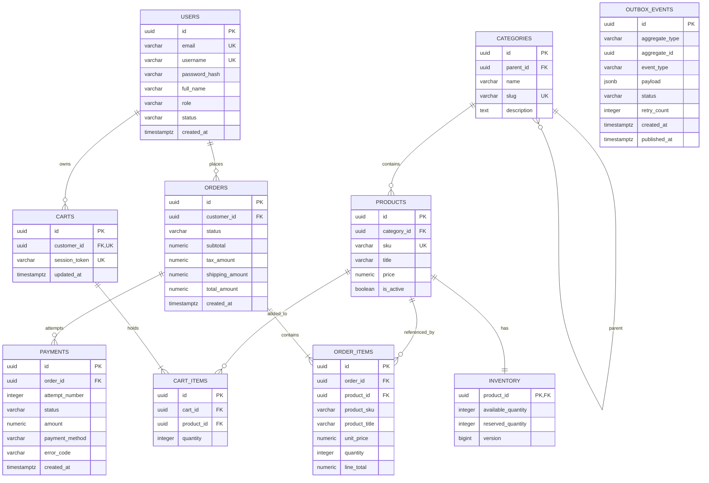

# Real-time E-commerce Analytics Platform
## Database Design Specification

---

## 1. Database Design Overview

### 1.1 Purpose
This document provides the formal **Database Design Specification** for the **Real-time E-commerce Analytics Platform**. It operationalizes the architectural blueprints defined in [`04-system-architecture.md`](file:///home/nguyen-son-minh/Downloads/Real-time%20E-commerce%20Analytics%20Platform/docs/04-system-architecture.md), translating functional requirements ([`02-requirements.md`](file:///home/nguyen-son-minh/Downloads/Real-time%20E-commerce%20Analytics%20Platform/docs/02-requirements.md)) and actor workflows ([`03-use-cases.md`](file:///home/nguyen-son-minh/Downloads/Real-time%20E-commerce%20Analytics%20Platform/docs/03-use-cases.md)) into exact physical and logical database schemas.

### 1.2 Dual-Tier Scope
1. **Operational Database (OLTP — PostgreSQL 16):** Fully normalized relational schema enforcing strict ACID guarantees, transactional inventory reservations, deterministic order state machine transitions, and reliable event publication via the **Transactional Outbox Pattern**.
2. **Analytical Lakehouse & Data Warehouse (OLAP — Logical Design):** Logical dimensional model (Star Schema: Fact and Dimension tables) defining grains, measures, slowly changing dimension policies, and lineage connecting Kafka event streams to analytical metrics.

```
+─────────────────────────────────────────────────────────────────────────────────────────────+
|                               DATABASE TOPOLOGY & FLOW                                      |
+─────────────────────────────────────────────────────────────────────────────────────────────+
|                                                                                             |
|   [ PostgreSQL 16 OLTP (Normalized 3NF) ]                                                   |
|   ├── users, categories, products, inventory                                                |
|   ├── carts, cart_items                                                                     |
|   ├── orders, order_items, payments                                                         |
|   └── outbox_events ────────┐ (Transactional Outbox)                                        |
|                             │                                                               |
|                             ▼ (Relay Publisher)                                             |
|   [ Apache Kafka Topics ] ──┴──────────────────────────────────┐                            |
|                                                                │                            |
|                                                                ▼ (Continuous Ingestion)     |
|   [ Lakehouse Bronze Layer ] (Raw Parquet Storage) ────────────┘                            |
|        │                                                                                    |
|        ▼ (PySpark Parse, Validate & Deduplicate)                                            |
|   [ Lakehouse Silver Layer ] (Conformed Parquet Storage)                                    |
|        │                                                                                    |
|        ▼ (PySpark Dimensional Modeling)                                                     |
|   [ Lakehouse Gold Layer / Analytical Store (Star Schema) ]                                 |
|   ├── Dimensions: dim_customers, dim_products, dim_categories, dim_date, dim_order_status   |
|   └── Facts:      fact_orders, fact_order_items, fact_payments, fact_product_views          |
|                                                                                             |
+─────────────────────────────────────────────────────────────────────────────────────────────+
```

---

## 2. Identifier Strategy

### 2.1 Trade-off Analysis: BIGINT vs. UUID

| Evaluation Criteria | `BIGINT` (Identity / Sequence) | `UUID` (Universally Unique Identifier) |
| :--- | :--- | :--- |
| **Space Footprint** | 8 bytes per record. Minimal index overhead. | 16 bytes per record. Higher index memory footprint. |
| **Generation Origin** | Database-generated only (`SERIAL` / `IDENTITY`). | Client- or application-generated prior to persistence. |
| **Enumeration Attack Risk** | High. Sequential IDs expose business volume (`/orders/101`). | Zero. Non-sequential random format prevents scraping. |
| **Distributed / Event Alignment**| Poor. Cannot generate Kafka `aggregate_id` before DB insert. | **Optimal.** Same ID serves as DB PK and Kafka `aggregate_id`. |
| **B-Tree Insertion Locality** | Sequential; minimal page splits. | Random (UUIDv4) causes page fragmentation. |

### 2.2 Selected Strategy: Application-Generated UUIDv4 / UUIDv7
To satisfy end-to-end event tracing without dual-key translation, the platform standardizes on **`UUID`** for all primary business and event entities:
- **Application Generation:** Spring Boot generates entity UUIDs before opening the database transaction, enabling immediate inclusion into the `outbox_events` payload within the same thread.
- **Unified Domain-to-Event Identity:** An order created with ID `c7b2a95e-...` carries that exact same ID across `orders.id`, Kafka `aggregate_id`, `outbox_events.aggregate_id`, `silver_orders.order_id`, and `fact_orders.order_id`.
- **Public Security:** External APIs expose UUIDs, preventing enumeration of total users, orders, and products.

---

## 3. PostgreSQL OLTP Schema Specification

The operational database consists of 10 tables organized into cohesive functional boundaries.

### 3.1 `users` Table
Stores registered customer accounts and administrative identities.

| Column | Type | Null | Key | Default | Constraint | Description |
| :--- | :--- | :---: | :---: | :--- | :--- | :--- |
| `id` | `UUID` | No | PK | — | — | Unique user identifier. |
| `email` | `VARCHAR(255)` | No | — | — | `UNIQUE` | Unique user email address (login credential). |
| `username` | `VARCHAR(100)` | No | — | — | `UNIQUE` | Unique public handle / username. |
| `password_hash` | `VARCHAR(255)` | No | — | — | — | Salted cryptographic hash (BCrypt). |
| `full_name` | `VARCHAR(255)` | No | — | — | — | User's full legal name. |
| `role` | `VARCHAR(50)` | No | — | `'CUSTOMER'` | `CHECK (role IN ('CUSTOMER', 'ADMIN'))` | Role-based authorization tier. |
| `status` | `VARCHAR(50)` | No | — | `'ACTIVE'` | `CHECK (status IN ('ACTIVE', 'LOCKED', 'DEACTIVATED'))` | Account lifecycle state. |
| `created_at` | `TIMESTAMPTZ` | No | — | `CURRENT_TIMESTAMP` | — | Timestamp of registration (UTC). |
| `updated_at` | `TIMESTAMPTZ` | No | — | `CURRENT_TIMESTAMP` | — | Timestamp of last profile update. |

---

### 3.2 `categories` Table
Organizes products into hierarchical classifications.

| Column | Type | Null | Key | Default | Constraint | Description |
| :--- | :--- | :---: | :---: | :--- | :--- | :--- |
| `id` | `UUID` | No | PK | — | — | Unique category identifier. |
| `parent_id` | `UUID` | Yes | FK | `NULL` | References `categories(id) ON DELETE SET NULL` | Parent category for hierarchical nesting. |
| `name` | `VARCHAR(100)` | No | — | — | — | Category display name. |
| `slug` | `VARCHAR(120)` | No | — | — | `UNIQUE` | URL-safe unique category slug. |
| `description` | `TEXT` | Yes | — | `NULL` | — | Category descriptive summary. |
| `created_at` | `TIMESTAMPTZ` | No | — | `CURRENT_TIMESTAMP` | — | Record creation timestamp. |
| `updated_at` | `TIMESTAMPTZ` | No | — | `CURRENT_TIMESTAMP` | — | Record modification timestamp. |

---

### 3.3 `products` Table
Houses catalog items and active retail pricing.

| Column | Type | Null | Key | Default | Constraint | Description |
| :--- | :--- | :---: | :---: | :--- | :--- | :--- |
| `id` | `UUID` | No | PK | — | — | Unique product identifier. |
| `category_id` | `UUID` | No | FK | — | References `categories(id) ON DELETE RESTRICT` | Category classification. |
| `sku` | `VARCHAR(100)` | No | — | — | `UNIQUE` | Unique Stock Keeping Unit code. |
| `title` | `VARCHAR(255)` | No | — | — | — | Product display title. |
| `description` | `TEXT` | Yes | — | `NULL` | — | Detailed specifications. |
| `price` | `NUMERIC(12, 2)`| No | — | — | `CHECK (price >= 0.00)` | Current base unit price. |
| `is_active` | `BOOLEAN` | No | — | `TRUE` | — | Catalog visibility flag. |
| `created_at` | `TIMESTAMPTZ` | No | — | `CURRENT_TIMESTAMP` | — | Catalog entry timestamp. |
| `updated_at` | `TIMESTAMPTZ` | No | — | `CURRENT_TIMESTAMP` | — | Catalog update timestamp. |

---

### 3.4 `inventory` Table
Maintains atomic stock balances and concurrency controls.

| Column | Type | Null | Key | Default | Constraint | Description |
| :--- | :--- | :---: | :---: | :--- | :--- | :--- |
| `product_id` | `UUID` | No | PK, FK | — | References `products(id) ON DELETE CASCADE` | 1:1 binding to catalog item. |
| `available_quantity`| `INTEGER` | No | — | `0` | `CHECK (available_quantity >= 0)` | Stock available for immediate reservation. |
| `reserved_quantity` | `INTEGER` | No | — | `0` | `CHECK (reserved_quantity >= 0)` | Stock held in `PENDING` orders. |
| `version` | `BIGINT` | No | — | `0` | — | Optimistic locking version counter. |
| `updated_at` | `TIMESTAMPTZ` | No | — | `CURRENT_TIMESTAMP` | — | Timestamp of last stock balance change. |

---

### 3.5 `carts` Table
Tracks active shopping cart sessions.

| Column | Type | Null | Key | Default | Constraint | Description |
| :--- | :--- | :---: | :---: | :--- | :--- | :--- |
| `id` | `UUID` | No | PK | — | — | Unique shopping cart identifier. |
| `customer_id` | `UUID` | Yes | FK | `NULL` | References `users(id) ON DELETE CASCADE`, `UNIQUE` | Authenticated owner (NULL for guests). |
| `session_token`| `VARCHAR(255)` | Yes | — | `NULL` | `UNIQUE` | Ephemeral guest session tracking token. |
| `created_at` | `TIMESTAMPTZ` | No | — | `CURRENT_TIMESTAMP` | — | Cart creation timestamp. |
| `updated_at` | `TIMESTAMPTZ` | No | — | `CURRENT_TIMESTAMP` | — | Last cart modification timestamp. |

---

### 3.6 `cart_items` Table
Maintains line items residing inside a cart.

| Column | Type | Null | Key | Default | Constraint | Description |
| :--- | :--- | :---: | :---: | :--- | :--- | :--- |
| `id` | `UUID` | No | PK | — | — | Unique cart item entry identifier. |
| `cart_id` | `UUID` | No | FK | — | References `carts(id) ON DELETE CASCADE` | Parent shopping cart reference. |
| `product_id` | `UUID` | No | FK | — | References `products(id) ON DELETE CASCADE` | Target catalog product reference. |
| `quantity` | `INTEGER` | No | — | `1` | `CHECK (quantity > 0 AND quantity <= 100)` | Desired item quantity. |
| `created_at` | `TIMESTAMPTZ` | No | — | `CURRENT_TIMESTAMP` | — | Added timestamp. |
| `updated_at` | `TIMESTAMPTZ` | No | — | `CURRENT_TIMESTAMP` | — | Quantity modified timestamp. |

*Table-Level Invariant:* `UNIQUE (cart_id, product_id)` ensures a product appears at most once per cart.

---

### 3.7 `orders` Table
Encapsulates formal customer purchase contracts and status transitions.

| Column | Type | Null | Key | Default | Constraint | Description |
| :--- | :--- | :---: | :---: | :--- | :--- | :--- |
| `id` | `UUID` | No | PK | — | — | Unique purchase order identifier. |
| `customer_id` | `UUID` | No | FK | — | References `users(id) ON DELETE RESTRICT` | Placing customer reference. |
| `status` | `VARCHAR(50)` | No | — | `'PENDING'` | `CHECK (status IN ('PENDING', 'PAID', 'PAYMENT_FAILED', 'CANCELLED', 'COMPLETED'))` | Current lifecycle state. |
| `subtotal` | `NUMERIC(12, 2)`| No | — | — | `CHECK (subtotal >= 0.00)` | Sum of line item amounts. |
| `tax_amount` | `NUMERIC(12, 2)`| No | — | `0.00` | `CHECK (tax_amount >= 0.00)` | Calculated sales tax. |
| `shipping_amount`| `NUMERIC(12, 2)`| No | — | `0.00` | `CHECK (shipping_amount >= 0.00)` | Shipping fee. |
| `total_amount`| `NUMERIC(12, 2)`| No | — | — | `CHECK (total_amount = subtotal + tax_amount + shipping_amount)` | Binding gross order total. |
| `created_at` | `TIMESTAMPTZ` | No | — | `CURRENT_TIMESTAMP` | — | Checkout creation timestamp. |
| `updated_at` | `TIMESTAMPTZ` | No | — | `CURRENT_TIMESTAMP` | — | Last status change timestamp. |

---

### 3.8 `order_items` Table
Preserves immutable point-in-time product snapshots and line totals.

| Column | Type | Null | Key | Default | Constraint | Description |
| :--- | :--- | :---: | :---: | :--- | :--- | :--- |
| `id` | `UUID` | No | PK | — | — | Unique order line identifier. |
| `order_id` | `UUID` | No | FK | — | References `orders(id) ON DELETE CASCADE` | Parent order reference. |
| `product_id` | `UUID` | No | FK | — | References `products(id) ON DELETE RESTRICT` | Originating catalog product ID. |
| `product_sku` | `VARCHAR(100)` | No | — | — | — | Immutable historical SKU snapshot. |
| `product_title`| `VARCHAR(255)` | No | — | — | — | Immutable historical title snapshot. |
| `unit_price` | `NUMERIC(12, 2)`| No | — | — | `CHECK (unit_price >= 0.00)` | Immutable historical price snapshot. |
| `quantity` | `INTEGER` | No | — | — | `CHECK (quantity > 0)` | Ordered quantity. |
| `line_total` | `NUMERIC(12, 2)`| No | — | — | `CHECK (line_total = unit_price * quantity)` | Calculated line total amount. |

---

### 3.9 `payments` Table
Records discrete financial settlement attempts against orders.

| Column | Type | Null | Key | Default | Constraint | Description |
| :--- | :--- | :---: | :---: | :--- | :--- | :--- |
| `id` | `UUID` | No | PK | — | — | Unique payment attempt identifier. |
| `order_id` | `UUID` | No | FK | — | References `orders(id) ON DELETE CASCADE` | Associated purchase order. |
| `attempt_number`| `INTEGER` | No | — | `1` | `CHECK (attempt_number >= 1)` | Chronological attempt sequence. |
| `status` | `VARCHAR(50)` | No | — | — | `CHECK (status IN ('SUCCESS', 'FAILED'))` | Settlement outcome. |
| `amount` | `NUMERIC(12, 2)`| No | — | — | `CHECK (amount >= 0.00)` | Transaction settlement amount. |
| `currency` | `VARCHAR(10)` | No | — | `'USD'` | — | ISO currency code. |
| `payment_method`| `VARCHAR(50)` | No | — | `'CREDIT_CARD'`| — | Payment method descriptor. |
| `error_code` | `VARCHAR(50)` | Yes | — | `NULL` | — | Error code (on failure). |
| `created_at` | `TIMESTAMPTZ` | No | — | `CURRENT_TIMESTAMP` | — | Settlement execution timestamp. |

*Table-Level Invariant:* `UNIQUE (order_id, attempt_number)` guarantees deterministic chronological ordering of attempts per order.

---

### 3.10 `outbox_events` Table
Implements the **Transactional Outbox Pattern**, staging domain events atomically within local business transactions.

| Column | Type | Null | Key | Default | Constraint | Description |
| :--- | :--- | :---: | :---: | :--- | :--- | :--- |
| `id` | `UUID` | No | PK | — | — | Unique event identifier (`event_id`). |
| `aggregate_type`| `VARCHAR(50)` | No | — | — | — | Domain entity type (`ORDER`, `PAYMENT`, etc.).|
| `aggregate_id` | `UUID` | No | — | — | — | Primary identifier of the affected aggregate.|
| `event_type` | `VARCHAR(100)` | No | — | — | — | Business event type name. |
| `schema_version`| `VARCHAR(20)` | No | — | `'1.0'` | — | Event contract schema version. |
| `payload` | `JSONB` | No | — | — | — | Full domain event payload. |
| `status` | `VARCHAR(50)` | No | — | `'PENDING'` | `CHECK (status IN ('PENDING', 'PUBLISHED', 'FAILED'))` | Dispatch lifecycle state. |
| `retry_count` | `INTEGER` | No | — | `0` | `CHECK (retry_count >= 0)` | Consecutive publishing failures count. |
| `created_at` | `TIMESTAMPTZ` | No | — | `CURRENT_TIMESTAMP` | — | Transaction commit timestamp. |
| `published_at`| `TIMESTAMPTZ` | Yes | — | `NULL` | — | Successful Kafka dispatch timestamp. |
| `last_error` | `TEXT` | Yes | — | `NULL` | — | Stack trace or broker error details. |

---

## 4. Order State Machine Integrity & Enforcement

The order lifecycle follows strict invariants established in [`02-requirements.md`](file:///home/nguyen-son-minh/Downloads/Real-time%20E-commerce%20Analytics%20Platform/docs/02-requirements.md) and [`03-use-cases.md`](file:///home/nguyen-son-minh/Downloads/Real-time%20E-commerce%20Analytics%20Platform/docs/03-use-cases.md):

```
                        ┌──────────────┐
                        │   PENDING    │
                        └──────┬───────┘
                               │
             ┌─────────────────┼─────────────────┐
             │                 │                 │
             ▼                 ▼                 ▼
    ┌──────────────────┐┌──────────────┐┌──────────────────┐
    │  PAYMENT_FAILED  ││     PAID     ││    CANCELLED     │ (Terminal)
    └────────┬─────────┘└──────┬───────┘└──────────────────┘
             │                 │
    ┌────────┴────────┐        ▼
    │ Retry Success   │ ┌──────────────┐
    ▼                 │ │  COMPLETED   │ (Terminal)
  (PAID)              │ └──────────────┘
                      ▼ (Cancel)
                 (CANCELLED)
```

### 4.1 State Transition Matrix

| Current State | Target State | Legal? | Enforcing Operation | Side Effects |
| :--- | :--- | :---: | :--- | :--- |
| `[None]` | `PENDING` | Yes | `UC-008` (Create Order) | Decrement stock; snapshot item prices; enqueue `ORDER_CREATED`. |
| `PENDING` | `PAID` | Yes | `UC-009` (Payment Success) | Insert payment attempt; enqueue `PAYMENT_COMPLETED` & `ORDER_PAID`. |
| `PENDING` | `PAYMENT_FAILED` | Yes | `UC-009` (Payment Rejection) | Insert payment failure; enqueue `PAYMENT_FAILED`; stock held. |
| `PENDING` | `CANCELLED` | Yes | `UC-011` (Cancel Order) | Restore stock; enqueue `ORDER_CANCELLED`. |
| `PAYMENT_FAILED` | `PAID` | Yes | `UC-010` (Retry Success) | Insert payment attempt; enqueue `PAYMENT_COMPLETED` & `ORDER_PAID`. |
| `PAYMENT_FAILED` | `CANCELLED` | Yes | `UC-011` (Cancel Order) | Restore stock; enqueue `ORDER_CANCELLED`. |
| `PAID` | `COMPLETED` | Yes | Store Fulfillment | Terminal state. |
| `CANCELLED` | *Any* | **No** | Prohibited (`BR-007`) | Throws `IllegalOrderStateTransitionException`. |
| `COMPLETED` | *Any* | **No** | Prohibited (`BR-007`) | Throws `IllegalOrderStateTransitionException`. |
| `PAID` | `PENDING` | **No** | Prohibited (`BR-007`) | Throws `IllegalOrderStateTransitionException`. |
| `PAID` | `PAYMENT_FAILED` | **No** | Prohibited (`BR-010`) | Throws `OrderAlreadyPaidException`. |

### 4.2 Multi-Layered Enforcement Architecture
1. **Application Layer:** State machine transitions are codified in the `Order` aggregate root via explicit methods (e.g., `order.markPaid()`, `order.cancel()`). Calling an illegal transition method throws a domain exception prior to DB flush.
2. **Database Concurrency Protection:** State mutations utilize conditional optimistic locking:
   ```sql
   UPDATE orders 
   SET status = 'PAID', updated_at = CURRENT_TIMESTAMP 
   WHERE id = :orderId AND status IN ('PENDING', 'PAYMENT_FAILED');
   ```
   If zero rows are updated, the application detects concurrent state manipulation and aborts the transaction safely.

---

## 5. Concurrency, Locking & Stock Reservation Strategy

### 5.1 Race Condition Analysis: The Overselling Vulnerability
Consider two concurrent customers checking out the last available items:
- Product $P_1$ has `available_quantity = 7`.
- Customer $A$ requests $5$ units.
- Customer $B$ requests $5$ units.

If both threads read `available_quantity = 7` simultaneously and update without serialization, available quantity becomes $-3$, resulting in overselling and broken business invariants (`BR-003`).

```
Thread A (Customer A)                        Thread B (Customer B)
         │                                            │
         ├── 1. Read Stock = 7                        ├── 1. Read Stock = 7
         │                                            │
         ├── 2. Calculate: 7 - 5 = 2                  ├── 2. Calculate: 7 - 5 = 2
         │                                            │
         ├── 3. Write Stock = 2                       │
         │      (Committed)                           ├── 3. Write Stock = 2
         │                                            │      (Overwrites! Total sold = 10, stock was 7!)
```

### 5.2 Resolution: Atomic Conditional Decrement
The platform eliminates this race condition without heavy table locks by using **atomic single-statement conditional updates**:

```sql
UPDATE inventory 
SET available_quantity = available_quantity - :requestedQty,
    reserved_quantity  = reserved_quantity + :requestedQty,
    version            = version + 1,
    updated_at         = CURRENT_TIMESTAMP
WHERE product_id = :productId 
  AND available_quantity >= :requestedQty;
```

**Database Invariant Guarantee:**
PostgreSQL acquires a row-level write lock on the specific `inventory` row during the `UPDATE`.
1. The first transaction to acquire the row lock evaluates `available_quantity >= 5` (True: $7 \ge 5$). It updates available stock to $2$, reserved to $5$, and commits.
2. The second transaction waits for the lock. Upon acquiring it, PostgreSQL evaluates the `WHERE` clause against the newly committed state ($2 \ge 5$, which evaluates to **False**).
3. The query affects **0 rows**.
4. Spring Data JPA detects `affected_rows == 0` and throws `InsufficientStockException`.
5. Transaction $B$ rolls back completely. **Zero overselling occurs.**

### 5.3 Idempotent Order Cancellation
When an order is cancelled (`UC-011`), stock must be restored exactly once:
```sql
-- Step 1: Atomic state transition
UPDATE orders 
SET status = 'CANCELLED', updated_at = CURRENT_TIMESTAMP 
WHERE id = :orderId AND status IN ('PENDING', 'PAYMENT_FAILED');

-- Step 2: Restore inventory ONLY if Step 1 updated 1 row
UPDATE inventory 
SET available_quantity = available_quantity + :qty,
    reserved_quantity  = reserved_quantity - :qty,
    version            = version + 1,
    updated_at         = CURRENT_TIMESTAMP
WHERE product_id = :productId;
```
If an order is already `CANCELLED`, Step 1 affects 0 rows, preventing duplicate stock replenishment upon request retries.

---

## 6. Transaction Boundaries & Use Case Execution

```
+──────────────────────────+───────────────────────────────────────────────────────────+───────────────────────+
| Use Case                 | Transaction Operations Enclosed in Single ACID Boundary   | Rollback Triggers     |
+──────────────────────────+───────────────────────────────────────────────────────────+───────────────────────+
| `UC-001` Register        | 1. INSERT users                                           | Duplicate email/user; |
|                          | 2. INSERT outbox_events (USER_REGISTERED)                 | DB connection failure.|
+──────────────────────────+───────────────────────────────────────────────────────────+───────────────────────+
| `UC-005` Add to Cart     | 1. SELECT product & inventory                             | Product inactive;     |
|                          | 2. INSERT/UPDATE cart_items                               | Insufficient stock.   |
|                          | 3. UPDATE carts.updated_at                                |                       |
+──────────────────────────+───────────────────────────────────────────────────────────+───────────────────────+
| `UC-008` Create Order    | 1. SELECT & validate active cart items                    | Empty cart;           |
|                          | 2. Atomic conditional UPDATE inventory (decrement stock)  | Out of stock (0 rows);|
|                          | 3. INSERT orders (status = PENDING)                       | Catalog invalidation; |
|                          | 4. INSERT order_items (price snapshot)                    | System error.         |
|                          | 5. DELETE cart_items                                      |                       |
|                          | 6. INSERT outbox_events (ORDER_CREATED)                   |                       |
+──────────────────────────+───────────────────────────────────────────────────────────+───────────────────────+
| `UC-009` Make Payment    | 1. SELECT orders FOR UPDATE (verify PENDING)              | Order not PENDING;    |
| (Success Branch)         | 2. INSERT payments (status = SUCCESS)                     | Order already PAID.   |
|                          | 3. UPDATE orders (status = PAID)                          |                       |
|                          | 4. INSERT outbox_events (PAYMENT_COMPLETED)               |                       |
|                          | 5. INSERT outbox_events (ORDER_PAID - GMV boundary)       |                       |
+──────────────────────────+───────────────────────────────────────────────────────────+───────────────────────+
| `UC-009` Make Payment    | 1. SELECT orders (verify PENDING)                         | Order not eligible;   |
| (Failure Branch)         | 2. INSERT payments (status = FAILED, error_code)          | System error.         |
|                          | 3. UPDATE orders (status = PAYMENT_FAILED)                |                       |
|                          | 4. INSERT outbox_events (PAYMENT_FAILED)                  |                       |
+──────────────────────────+───────────────────────────────────────────────────────────+───────────────────────+
| `UC-011` Cancel Order    | 1. UPDATE orders (PENDING/FAILED -> CANCELLED)            | Order already PAID;   |
|                          | 2. UPDATE inventory (restore available_quantity)          | Order already CANCEL. |
|                          | 3. INSERT outbox_events (ORDER_CANCELLED)                 |                       |
+──────────────────────────+───────────────────────────────────────────────────────────+───────────────────────+
```

---

## 7. Index Design & Optimization

Indexes are introduced strictly to satisfy specific query workloads and high-frequency join paths:

```sql
-- 1. USERS: Accelerated login lookup and uniqueness enforcement
CREATE UNIQUE INDEX idx_users_email ON users(email);
CREATE UNIQUE INDEX idx_users_username ON users(username);

-- 2. PRODUCTS & CATEGORIES: Catalog browsing, category filtering, SKU lookups
CREATE UNIQUE INDEX idx_products_sku ON products(sku);
CREATE INDEX idx_products_category_active ON products(category_id, is_active) WHERE is_active = TRUE;
CREATE UNIQUE INDEX idx_categories_slug ON categories(slug);

-- 3. CARTS & CART ITEMS: User cart retrieval and cart-line joins
CREATE UNIQUE INDEX idx_carts_customer ON carts(customer_id) WHERE customer_id IS NOT NULL;
CREATE UNIQUE INDEX idx_cart_items_unique ON cart_items(cart_id, product_id);
CREATE INDEX idx_cart_items_cart_id ON cart_items(cart_id);

-- 4. ORDERS & ORDER ITEMS: Customer order history inspection and order lines
CREATE INDEX idx_orders_customer_created ON orders(customer_id, created_at DESC);
CREATE INDEX idx_orders_status ON orders(status);
CREATE INDEX idx_order_items_order_id ON order_items(order_id);

-- 5. PAYMENTS: Historical payment audit lookups and attempt ordering
CREATE UNIQUE INDEX idx_payments_order_attempt ON payments(order_id, attempt_number);
CREATE INDEX idx_payments_order_id ON payments(order_id);

-- 6. TRANSACTIONAL OUTBOX: High-speed polling of pending events
CREATE INDEX idx_outbox_pending ON outbox_events(status, created_at ASC) WHERE status = 'PENDING';
CREATE INDEX idx_outbox_aggregate ON outbox_events(aggregate_type, aggregate_id);
```

### Justification for Partial Index on `outbox_events`
The outbox relay worker polls pending events continuously. A standard index on `status` degrades as millions of events accumulate in `PUBLISHED` state. The partial index `WHERE status = 'PENDING'` indexes **only** active un-dispatched rows (typically $< 100$ records), maintaining microscopic index size and sub-millisecond query execution.

---

## 8. Outbox Polling & Concurrency Control

### 8.1 Non-Blocking Worker Dispatch (`SKIP LOCKED`)
To support reliable, concurrent polling without worker collisions or row contention, the outbox relay executes:

```sql
SELECT id, aggregate_type, aggregate_id, event_type, payload
FROM outbox_events
WHERE status = 'PENDING'
ORDER BY created_at ASC
LIMIT 100
FOR UPDATE SKIP LOCKED;
```

1. **`FOR UPDATE`:** Acquires exclusive row locks on the returned batch.
2. **`SKIP LOCKED`:** If multiple relay threads or instances run concurrently, other workers skip locked rows and claim the next available slice, eliminating deadlock risks and lock wait latency.
3. **Dispatch & Mark:** Worker publishes messages to Kafka. Upon broker acknowledgment, worker marks rows `status = 'PUBLISHED'` and sets `published_at = CURRENT_TIMESTAMP`.

---

## 9. Normalization & Deliberate Denormalization Strategy

### 9.1 Third Normal Form (3NF) Compliance
The operational relational model strictly conforms to 3NF:
- Tables possess distinct primary keys.
- All non-key attributes are fully functionally dependent on the primary key (no partial dependencies).
- No non-key attribute depends transitively on another non-key attribute (e.g., category details live in `categories`, not duplicated on `products`).

### 9.2 Deliberate Denormalization: Historical Order Snapshots
`order_items` explicitly duplicates `product_title`, `product_sku`, and `unit_price` alongside `product_id`.

**Architectural Rationale:**
- **Regulatory & Business Invariant:** In commerce, a completed purchase order is an immutable legal contract. If a laptop is purchased for \$1,299.99 and the merchant subsequently raises the catalog price to \$1,499.99 or renames the SKU, historical invoices and financial accounting must **never** reflect the updated price (`BR-002`).
- **Decoupling from Catalog Deletion:** If a product is discontinued and soft-deleted in `products`, the historical `order_items` record remains intact and self-contained without broken joins.

---

## 10. Analytical Database Design (Gold Tier — Star Schema)

The analytical store models data into a Star Schema optimized for OLAP aggregations without operational database contention.

```
                  ┌──────────────────────┐
                  │    dim_customers     │
                  ├──────────────────────┤
                  │ customer_key (PK)    │
                  │ customer_id (NK)     │
                  │ full_name            │
                  │ email                │
                  │ registration_date    │
                  └──────────▲───────────┘
                             │
                             │ customer_key
                             │
┌──────────────────┐   ┌─────┴─────────────────────────────────┐   ┌──────────────────────┐
│  dim_order_status│   │              fact_orders              │   │     dim_products     │
├──────────────────┤   ├───────────────────────────────────────┤   ├──────────────────────┤
│ status_key (PK)  │◄──┤ order_key (PK)                        ├──►│ product_key (PK)     │
│ status_code      │   │ order_id (NK)                         │   │ product_id (NK)      │
│ status_name      │   │ customer_key (FK)                     │   │ sku                  │
└──────────────────┘   │ date_key (FK)                         │   │ title                │
                       │ status_key (FK)                       │   │ category_name        │
                       │ subtotal_amount                       │   │ current_price        │
                       │ tax_amount                            │   └──────────────────────┘
                       │ shipping_amount                       │
                       │ total_amount                          │
                       │ gmv_amount (0 if not PAID)            │
                       │ is_paid (BOOLEAN)                     │
                       └──────────────────┬────────────────────┘
                                          │
                                          │ date_key
                                          ▼
                               ┌──────────────────────┐
                               │       dim_date       │
                               ├──────────────────────┤
                               │ date_key (PK)        │
                               │ calendar_date        │
                               │ day_of_week          │
                               │ month, quarter, year │
                               └──────────────────────┘
```

### 10.1 Dimension Tables Specifications

#### `dim_customers`
- **Grain:** One row per registered customer.
- **Columns:** `customer_key` (BIGINT PK surrogate), `customer_id` (UUID natural key), `full_name`, `email`, `registration_date_key` (FK to `dim_date`), `current_status`.

#### `dim_products`
- **Grain:** One row per catalog product.
- **Columns:** `product_key` (BIGINT PK surrogate), `product_id` (UUID natural key), `sku`, `title`, `category_name`, `base_price`, `is_active`.

#### `dim_categories`
- **Grain:** One row per product category.
- **Columns:** `category_key` (BIGINT PK surrogate), `category_id` (UUID natural key), `category_name`, `slug`, `parent_category_name`.

#### `dim_date`
- **Grain:** One row per calendar day.
- **Columns:** `date_key` (INTEGER PK format `YYYYMMDD`), `calendar_date` (DATE), `day_of_month`, `day_name`, `day_of_week`, `is_weekend`, `week_of_year`, `month_number`, `month_name`, `quarter`, `year`.

#### `dim_order_status`
- **Grain:** One row per legal order state.
- **Columns:** `status_key` (INTEGER PK), `status_code` (`PENDING`, `PAID`, `PAYMENT_FAILED`, `CANCELLED`, `COMPLETED`), `is_terminal` (BOOLEAN).

---

### 10.2 Fact Tables Specifications

#### `fact_orders`
- **Grain:** Exactly **one row per purchase order**.
- **Role:** Central fact for overall sales velocity, order volumes, conversion, and Gross Merchandise Value.
- **Measures:**
  - `subtotal_amount` (`NUMERIC(12, 2)`)
  - `tax_amount` (`NUMERIC(12, 2)`)
  - `shipping_amount` (`NUMERIC(12, 2)`)
  - `total_amount` (`NUMERIC(12, 2)`)
  - `gmv_amount` (`NUMERIC(12, 2)`): **Calculated as `total_amount` if `is_paid = TRUE` else `0.00`**.
- **Keys:** `order_key` (PK), `order_id` (Natural Key), `customer_key` (FK), `date_key` (FK), `status_key` (FK).
- **Flags:** `is_paid` (BOOLEAN), `is_cancelled` (BOOLEAN).

#### `fact_order_items`
- **Grain:** Exactly **one row per line item within an order**.
- **Role:** Enables granular product-level and category-level margin and revenue aggregation.
- **Measures:**
  - `unit_price` (`NUMERIC(12, 2)`)
  - `quantity` (`INTEGER`)
  - `line_total` (`NUMERIC(12, 2)`)
- **Keys:** `order_item_key` (PK), `order_key` (FK), `product_key` (FK), `date_key` (FK).

#### `fact_payments`
- **Grain:** Exactly **one row per simulated payment attempt**.
- **Role:** Powers payment gateway reliability analysis, settlement failure distribution, and error tracking.
- **Measures:** `amount` (`NUMERIC(12, 2)`), `attempt_number` (`INTEGER`).
- **Keys:** `payment_key` (PK), `payment_id` (Natural Key), `order_key` (FK), `date_key` (FK).
- **Attributes:** `status` (`SUCCESS`, `FAILED`), `payment_method`, `error_code`.

#### `fact_product_views`
- **Grain:** Exactly **one row per product inspection event**.
- **Role:** Feeds the top of the e-commerce conversion funnel (views $\rightarrow$ carts $\rightarrow$ orders).
- **Keys:** `view_key` (PK), `product_key` (FK), `customer_key` (FK, unassigned surrogate for guests), `date_key` (FK).
- **Attributes:** `view_timestamp` (`TIMESTAMPTZ`), `viewed_price` (`NUMERIC(12, 2)`).

---

## 11. Gross Merchandise Value (GMV) Recognition Policy

```
[ ORDER_CREATED Event ] ──► fact_orders (is_paid = FALSE, gmv_amount = 0.00)
                                      │
[ PAYMENT_FAILED Event ] ─────────────┤ (Still is_paid = FALSE, gmv_amount = 0.00)
                                      │
[ ORDER_PAID Event ] ─────────────────► fact_orders (is_paid = TRUE, gmv_amount = total_amount)
                                      │  ==> OFFICIALLY RECOGNIZED IN GMV
                                      │
[ ORDER_CANCELLED Event ] ────────────► fact_orders (is_cancelled = TRUE, gmv_amount = 0.00)
                                         ==> DEDUCTED / EXCLUDED FROM GMV
```

### Invariant Rules
1. **`ORDER_PAID` Exclusivity:** GMV is recognized in `fact_orders` **if and only if** the order consumes an `ORDER_PAID` event (`BR-012`).
2. **Payment Attempt Isolation:** Multiple payment attempts generating multiple `PAYMENT_FAILED` records in `fact_payments` have zero impact on GMV. `fact_payments` reconciles cash movement; `fact_orders` records commercial GMV.
3. **Cancellation Exclusion:** If an order in `PENDING` or `PAYMENT_FAILED` state transitions to `CANCELLED`, its `gmv_amount` is strictly zero (`BR-013`).

---

## 12. Slowly Changing Dimensions (SCD) Policy

| Dimension | Selected SCD Strategy | Rationale & Trade-off | Columns Tracked |
| :--- | :---: | :--- | :--- |
| **`dim_customers`** | **SCD Type 1** (Overwrite) | Portfolio scope does not require historical customer address audit trails. Updates overwrite existing profile values. | `full_name`, `email`, `current_status`. |
| **`dim_products`** | **SCD Type 1** (Overwrite) | Historical order item prices are already permanently preserved in `order_items` and `fact_order_items`. Overwriting catalog metadata simplifies dimension modeling. | `title`, `category_name`, `base_price`, `is_active`. |
| **`dim_categories`**| **SCD Type 1** (Overwrite) | Category restructuring is infrequent; historical taxonomy tracking is out of scope. | `category_name`, `slug`. |
| **`dim_date`** | **Static / Pre-populated** | Fixed Gregorian calendar dimension table generated once spanning 2024–2030. | All calendar fields. |

---

## 13. End-to-End Data Lineage Mapping

```
+──────────────────────────+─────────────────────────+─────────────────────────+─────────────────────────+──────────────────────────+
| Operational PostgreSQL   | Kafka Domain Event      | Lakehouse Bronze Tier   | Lakehouse Silver Tier   | Gold Fact & Dim Tier     |
+──────────────────────────+─────────────────────────+─────────────────────────+─────────────────────────+──────────────────────────+
| `orders.id`              | `payload.order_id`      | `raw_payload.order_id`  | `silver_orders.order_id`| `fact_orders.order_id`   |
| `orders.customer_id`     | `payload.customer_id`   | `raw_payload.customer_id`| `silver_orders.cust_id`| `fact_orders.cust_key`   |
| `orders.total_amount`    | `payload.total_amount`  | `raw_payload.total`     | `silver_orders.total`   | `fact_orders.total_amount|
| `orders.status = 'PAID'` | `ORDER_PAID`            | `event_type='ORDER_PAID'`| `silver_orders.is_paid` | `fact_orders.gmv_amount` |
| `order_items.unit_price` | `items[].unit_price`    | `raw_payload.items[].pr`| `silver_items.unit_price| `fact_items.unit_price`  |
| `order_items.quantity`   | `items[].quantity`      | `raw_payload.items[].qty| `silver_items.quantity` | `fact_items.quantity`    |
| `payments.status`        | `PAYMENT_COMPLETED`     | `event_type='PAY_COMP'` | `silver_payments.status`| `fact_payments.status`   |
+──────────────────────────+─────────────────────────+─────────────────────────+─────────────────────────+──────────────────────────+
```

---

## 14. Data Retention & Archival Policies

```
+──────────────────────────+───────────────────────+───────────────────────────+──────────────────────────────────────────────────+
| Storage Tier             | Target Engine         | Retention Policy Period   | Lifecycle & Compaction Strategy                  |
+──────────────────────────+───────────────────────+───────────────────────────+──────────────────────────────────────────────────+
| **OLTP Database**        | PostgreSQL 16         | Permanent (Operational)   | Business tables retained permanently for audit.  |
| **Transactional Outbox** | PostgreSQL 16         | 7 Days post-dispatch      | Background job deletes `PUBLISHED` outbox rows.  |
| **Kafka Event Bus**      | Apache Kafka          | 7 Days (Configurable)     | Time-based log segment cleanup (`delete`).       |
| **Bronze Layer**         | MinIO / Local Parquet | Permanent (Single Source) | Read-only raw storage; basis for full replay.    |
| **Silver Layer**         | MinIO / Local Parquet | 90 Days / Rebuildable     | Partition overwrites during reprocessing.        |
| **Gold Layer**           | MinIO / Analytical DB | Permanent (Analytical)    | Compacted analytical dimensional tables.         |
+──────────────────────────+───────────────────────+───────────────────────────+──────────────────────────────────────────────────+
```

---

## 15. Entity-Relationship Diagrams (ERD)

### 15.1 Operational PostgreSQL ERD (OLTP)


### 15.2 Analytical Star Schema ERD (OLAP Gold Tier)
```mermaid
erDiagram
    DIM_CUSTOMERS ||--o{ FACT_ORDERS : places
    DIM_CUSTOMERS ||--o{ FACT_PRODUCT_VIEWS : views
    DIM_PRODUCTS ||--o{ FACT_ORDER_ITEMS : line_product
    DIM_PRODUCTS ||--o{ FACT_PRODUCT_VIEWS : inspected_product
    DIM_DATE ||--o{ FACT_ORDERS : order_date
    DIM_DATE ||--o{ FACT_PAYMENTS : payment_date
    DIM_DATE ||--o{ FACT_PRODUCT_VIEWS : view_date
    DIM_ORDER_STATUS ||--o{ FACT_ORDERS : order_status
    FACT_ORDERS ||--|{ FACT_ORDER_ITEMS : itemizes
    FACT_ORDERS ||--o{ FACT_PAYMENTS : settles

    DIM_CUSTOMERS {
        bigint customer_key PK
        uuid customer_id NK
        varchar full_name
        varchar email
    }

    DIM_PRODUCTS {
        bigint product_key PK
        uuid product_id NK
        varchar sku
        varchar title
        varchar category_name
        numeric base_price
    }

    DIM_DATE {
        integer date_key PK
        date calendar_date
        integer month_number
        integer year
    }

    DIM_ORDER_STATUS {
        integer status_key PK
        varchar status_code
    }

    FACT_ORDERS {
        bigint order_key PK
        uuid order_id NK
        bigint customer_key FK
        integer date_key FK
        integer status_key FK
        numeric total_amount
        numeric gmv_amount
        boolean is_paid
    }

    FACT_ORDER_ITEMS {
        bigint order_item_key PK
        bigint order_key FK
        bigint product_key FK
        integer quantity
        numeric unit_price
        numeric line_total
    }

    FACT_PAYMENTS {
        bigint payment_key PK
        uuid payment_id NK
        bigint order_key FK
        integer date_key FK
        numeric amount
        varchar status
    }

    FACT_PRODUCT_VIEWS {
        bigint view_key PK
        bigint product_key FK
        bigint customer_key FK
        integer date_key FK
        timestamptz view_timestamp
    }
```

---

## 16. Complete DDL Specification (PostgreSQL 16)

```sql
-- ============================================================================
-- EXTENSIONS & CUSTOM DOMAINS
-- ============================================================================
CREATE EXTENSION IF NOT EXISTS "uuid-ossp";

-- ============================================================================
-- 1. USERS TABLE
-- ============================================================================
CREATE TABLE users (
    id            UUID PRIMARY KEY DEFAULT gen_random_uuid(),
    email         VARCHAR(255) NOT NULL,
    username      VARCHAR(100) NOT NULL,
    password_hash VARCHAR(255) NOT NULL,
    full_name     VARCHAR(255) NOT NULL,
    role          VARCHAR(50)  NOT NULL DEFAULT 'CUSTOMER',
    status        VARCHAR(50)  NOT NULL DEFAULT 'ACTIVE',
    created_at    TIMESTAMPTZ  NOT NULL DEFAULT CURRENT_TIMESTAMP,
    updated_at    TIMESTAMPTZ  NOT NULL DEFAULT CURRENT_TIMESTAMP,
    CONSTRAINT chk_users_role CHECK (role IN ('CUSTOMER', 'ADMIN')),
    CONSTRAINT chk_users_status CHECK (status IN ('ACTIVE', 'LOCKED', 'DEACTIVATED'))
);

CREATE UNIQUE INDEX idx_users_email ON users(email);
CREATE UNIQUE INDEX idx_users_username ON users(username);

-- ============================================================================
-- 2. CATEGORIES TABLE
-- ============================================================================
CREATE TABLE categories (
    id          UUID PRIMARY KEY DEFAULT gen_random_uuid(),
    parent_id   UUID REFERENCES categories(id) ON DELETE SET NULL,
    name        VARCHAR(100) NOT NULL,
    slug        VARCHAR(120) NOT NULL,
    description TEXT,
    created_at  TIMESTAMPTZ  NOT NULL DEFAULT CURRENT_TIMESTAMP,
    updated_at  TIMESTAMPTZ  NOT NULL DEFAULT CURRENT_TIMESTAMP
);

CREATE UNIQUE INDEX idx_categories_slug ON categories(slug);

-- ============================================================================
-- 3. PRODUCTS TABLE
-- ============================================================================
CREATE TABLE products (
    id          UUID PRIMARY KEY DEFAULT gen_random_uuid(),
    category_id UUID NOT NULL REFERENCES categories(id) ON DELETE RESTRICT,
    sku         VARCHAR(100) NOT NULL,
    title       VARCHAR(255) NOT NULL,
    description TEXT,
    price       NUMERIC(12, 2) NOT NULL,
    is_active   BOOLEAN NOT NULL DEFAULT TRUE,
    created_at  TIMESTAMPTZ NOT NULL DEFAULT CURRENT_TIMESTAMP,
    updated_at  TIMESTAMPTZ NOT NULL DEFAULT CURRENT_TIMESTAMP,
    CONSTRAINT chk_products_price CHECK (price >= 0.00)
);

CREATE UNIQUE INDEX idx_products_sku ON products(sku);
CREATE INDEX idx_products_category_active ON products(category_id, is_active) WHERE is_active = TRUE;

-- ============================================================================
-- 4. INVENTORY TABLE
-- ============================================================================
CREATE TABLE inventory (
    product_id         UUID PRIMARY KEY REFERENCES products(id) ON DELETE CASCADE,
    available_quantity INTEGER NOT NULL DEFAULT 0,
    reserved_quantity  INTEGER NOT NULL DEFAULT 0,
    version            BIGINT NOT NULL DEFAULT 0,
    updated_at         TIMESTAMPTZ NOT NULL DEFAULT CURRENT_TIMESTAMP,
    CONSTRAINT chk_inventory_available CHECK (available_quantity >= 0),
    CONSTRAINT chk_inventory_reserved CHECK (reserved_quantity >= 0)
);

-- ============================================================================
-- 5. CARTS & CART ITEMS TABLES
-- ============================================================================
CREATE TABLE carts (
    id            UUID PRIMARY KEY DEFAULT gen_random_uuid(),
    customer_id   UUID REFERENCES users(id) ON DELETE CASCADE,
    session_token VARCHAR(255),
    created_at    TIMESTAMPTZ NOT NULL DEFAULT CURRENT_TIMESTAMP,
    updated_at    TIMESTAMPTZ NOT NULL DEFAULT CURRENT_TIMESTAMP
);

CREATE UNIQUE INDEX idx_carts_customer ON carts(customer_id) WHERE customer_id IS NOT NULL;
CREATE UNIQUE INDEX idx_carts_session ON carts(session_token) WHERE session_token IS NOT NULL;

CREATE TABLE cart_items (
    id         UUID PRIMARY KEY DEFAULT gen_random_uuid(),
    cart_id    UUID NOT NULL REFERENCES carts(id) ON DELETE CASCADE,
    product_id UUID NOT NULL REFERENCES products(id) ON DELETE CASCADE,
    quantity   INTEGER NOT NULL DEFAULT 1,
    created_at TIMESTAMPTZ NOT NULL DEFAULT CURRENT_TIMESTAMP,
    updated_at TIMESTAMPTZ NOT NULL DEFAULT CURRENT_TIMESTAMP,
    CONSTRAINT chk_cart_items_quantity CHECK (quantity > 0 AND quantity <= 100),
    CONSTRAINT uq_cart_product UNIQUE (cart_id, product_id)
);

CREATE INDEX idx_cart_items_cart_id ON cart_items(cart_id);

-- ============================================================================
-- 6. ORDERS & ORDER ITEMS TABLES
-- ============================================================================
CREATE TABLE orders (
    id              UUID PRIMARY KEY DEFAULT gen_random_uuid(),
    customer_id     UUID NOT NULL REFERENCES users(id) ON DELETE RESTRICT,
    status          VARCHAR(50) NOT NULL DEFAULT 'PENDING',
    subtotal        NUMERIC(12, 2) NOT NULL,
    tax_amount      NUMERIC(12, 2) NOT NULL DEFAULT 0.00,
    shipping_amount NUMERIC(12, 2) NOT NULL DEFAULT 0.00,
    total_amount    NUMERIC(12, 2) NOT NULL,
    created_at      TIMESTAMPTZ NOT NULL DEFAULT CURRENT_TIMESTAMP,
    updated_at      TIMESTAMPTZ NOT NULL DEFAULT CURRENT_TIMESTAMP,
    CONSTRAINT chk_orders_status CHECK (status IN ('PENDING', 'PAID', 'PAYMENT_FAILED', 'CANCELLED', 'COMPLETED')),
    CONSTRAINT chk_orders_subtotal CHECK (subtotal >= 0.00),
    CONSTRAINT chk_orders_tax CHECK (tax_amount >= 0.00),
    CONSTRAINT chk_orders_shipping CHECK (shipping_amount >= 0.00),
    CONSTRAINT chk_orders_total CHECK (total_amount = subtotal + tax_amount + shipping_amount)
);

CREATE INDEX idx_orders_customer_created ON orders(customer_id, created_at DESC);
CREATE INDEX idx_orders_status ON orders(status);

CREATE TABLE order_items (
    id            UUID PRIMARY KEY DEFAULT gen_random_uuid(),
    order_id      UUID NOT NULL REFERENCES orders(id) ON DELETE CASCADE,
    product_id    UUID NOT NULL REFERENCES products(id) ON DELETE RESTRICT,
    product_sku   VARCHAR(100) NOT NULL,
    product_title VARCHAR(255) NOT NULL,
    unit_price    NUMERIC(12, 2) NOT NULL,
    quantity      INTEGER NOT NULL,
    line_total    NUMERIC(12, 2) NOT NULL,
    CONSTRAINT chk_order_items_qty CHECK (quantity > 0),
    CONSTRAINT chk_order_items_price CHECK (unit_price >= 0.00),
    CONSTRAINT chk_order_items_total CHECK (line_total = unit_price * quantity)
);

CREATE INDEX idx_order_items_order_id ON order_items(order_id);

-- ============================================================================
-- 7. PAYMENTS TABLE
-- ============================================================================
CREATE TABLE payments (
    id             UUID PRIMARY KEY DEFAULT gen_random_uuid(),
    order_id       UUID NOT NULL REFERENCES orders(id) ON DELETE CASCADE,
    attempt_number INTEGER NOT NULL DEFAULT 1,
    status         VARCHAR(50) NOT NULL,
    amount         NUMERIC(12, 2) NOT NULL,
    currency       VARCHAR(10) NOT NULL DEFAULT 'USD',
    payment_method VARCHAR(50) NOT NULL DEFAULT 'CREDIT_CARD',
    error_code     VARCHAR(50),
    created_at     TIMESTAMPTZ NOT NULL DEFAULT CURRENT_TIMESTAMP,
    CONSTRAINT chk_payments_attempt CHECK (attempt_number >= 1),
    CONSTRAINT chk_payments_status CHECK (status IN ('SUCCESS', 'FAILED')),
    CONSTRAINT chk_payments_amount CHECK (amount >= 0.00),
    CONSTRAINT uq_order_attempt UNIQUE (order_id, attempt_number)
);

CREATE INDEX idx_payments_order_id ON payments(order_id);

-- ============================================================================
-- 8. TRANSACTIONAL OUTBOX EVENTS TABLE
-- ============================================================================
CREATE TABLE outbox_events (
    id             UUID PRIMARY KEY DEFAULT gen_random_uuid(),
    aggregate_type VARCHAR(50) NOT NULL,
    aggregate_id   UUID NOT NULL,
    event_type     VARCHAR(100) NOT NULL,
    schema_version VARCHAR(20) NOT NULL DEFAULT '1.0',
    payload        JSONB NOT NULL,
    status         VARCHAR(50) NOT NULL DEFAULT 'PENDING',
    retry_count    INTEGER NOT NULL DEFAULT 0,
    created_at     TIMESTAMPTZ NOT NULL DEFAULT CURRENT_TIMESTAMP,
    published_at   TIMESTAMPTZ,
    last_error     TEXT,
    CONSTRAINT chk_outbox_status CHECK (status IN ('PENDING', 'PUBLISHED', 'FAILED')),
    CONSTRAINT chk_outbox_retry CHECK (retry_count >= 0)
);

CREATE INDEX idx_outbox_pending ON outbox_events(status, created_at ASC) WHERE status = 'PENDING';
CREATE INDEX idx_outbox_aggregate ON outbox_events(aggregate_type, aggregate_id);
```

---

## 17. Requirement Traceability Matrix

| Database Construct | Addressed Requirements & Business Rules | Use Case Alignment |
| :--- | :--- | :--- |
| `users` | `FR-001`, `FR-002`, `FR-003`, `NFR-016` | `UC-001`, `UC-002`, `UC-002A` |
| `categories`, `products` | `FR-005`, `FR-006`, `FR-007`, `BR-001` | `UC-003`, `UC-004`, `UC-ADMIN-001` |
| `inventory` | `FR-017`, `BR-003`, `BR-008` | `UC-008`, `UC-011`, `UC-ADMIN-003` |
| `carts`, `cart_items` | `FR-009` - `FR-014`, `BR-004`, `BR-005` | `UC-005`, `UC-006`, `UC-007` |
| `orders`, `order_items` | `FR-015` - `FR-022`, `BR-002`, `BR-006`, `BR-007`| `UC-008`, `UC-011`, `UC-012` |
| `payments` | `FR-023` - `FR-027`, `BR-009`, `BR-010`, `BR-011`| `UC-009`, `UC-010` |
| `outbox_events` | `ER-001` - `ER-004`, `DRIR-001`, `ADR-005` | All Event-Emitting Use Cases |
| `fact_orders` (Gold) | `AR-001` (GMV), `AR-002` (AOV), `BR-012` | `UC-DATA-003`, `UC-ADMIN-004` |
| `fact_order_items` (Gold)| `AR-004` (Top Products), `AR-005` (Category) | `UC-DATA-003`, `UC-ADMIN-004` |
| `fact_payments` (Gold) | `AR-011` (Settlement Rate), `NFR-015` | `UC-DATA-003`, `UC-ADMIN-004` |
| `fact_product_views` (Gold)| `AR-006` (Conversion Funnel Drop-off) | `UC-DATA-003`, `UC-ADMIN-004` |

---

## 18. Database Design Principles

1. **PostgreSQL as the Transactional Source of Truth:** All transactional state originates and commits within PostgreSQL. Caches and analytical models are downstream replicas.
2. **Database-Level Invariant Enforcement:** Critical business invariants (`available_quantity >= 0`, `price >= 0`, `total_amount = subtotal + tax + shipping`) are guarded by database `CHECK` constraints to guarantee data integrity even in the event of application bugs.
3. **Atomic Inventory Protection:** Stock decrements use conditional atomic updates (`available >= requested`) to eliminate overselling without distributed locks.
4. **Permanent Historical Snapshots:** Completed orders snapshot product titles, SKUs, and unit prices in `order_items`, permanently insulating legal purchase records from future catalog changes.
5. **State Transition Protection:** Order status progression is governed by strict state validation at both application and query levels, eliminating invalid skips or updates from terminal states.
6. **Immutable Payment History:** Payment attempts are stored as append-only audit records (`attempt_number`), preserving failure codes alongside subsequent successes.
7. **Atomic Outbox Persistence:** Domain events are committed in the same database transaction as operational mutations, eliminating dual-write inconsistencies.
8. **Decoupled Analytical Lakehouse:** Analytical pipelines process data exclusively from Kafka event streams into Bronze $\rightarrow$ Silver $\rightarrow$ Gold, with zero direct analytical queries targeting PostgreSQL.
9. **Authoritative GMV Boundary:** Gross Merchandise Value is credited strictly upon consumption of `ORDER_PAID`, preventing double-counting across payment retries.
10. **Replayability Guarantee:** The entire analytical Gold layer can be dropped and reconstructed from Bronze raw Parquet storage.
11. **Justified Index Footprint:** Every index corresponds directly to high-frequency query filters, join conditions, or partial polling predicates.
12. **Local Machine Feasibility:** Relational and analytical designs avoid distributed database bloat, executing deterministically on a 16 GB RAM local development environment.

---

## 19. Database Design Readiness

**Status:** `READY FOR DATA MODEL & PIPELINE DESIGN`

**Prerequisites Completed:**
- [`docs/01-project-brief.md`](file:///home/nguyen-son-minh/Downloads/Real-time%20E-commerce%20Analytics%20Platform/docs/01-project-brief.md)
- [`docs/02-requirements.md`](file:///home/nguyen-son-minh/Downloads/Real-time%20E-commerce%20Analytics%20Platform/docs/02-requirements.md)
- [`docs/03-use-cases.md`](file:///home/nguyen-son-minh/Downloads/Real-time%20E-commerce%20Analytics%20Platform/docs/03-use-cases.md)
- [`docs/04-system-architecture.md`](file:///home/nguyen-son-minh/Downloads/Real-time%20E-commerce%20Analytics%20Platform/docs/04-system-architecture.md)

**Next Deliverable:**
- `docs/06-data-model.md` (Detailed Star Schema Specifications, Surrogate Key Design, Dimensional Conformance, Aggregation Rollup Tables, and SQL Reporting Views).
