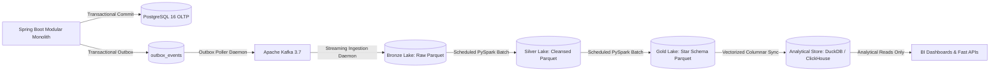
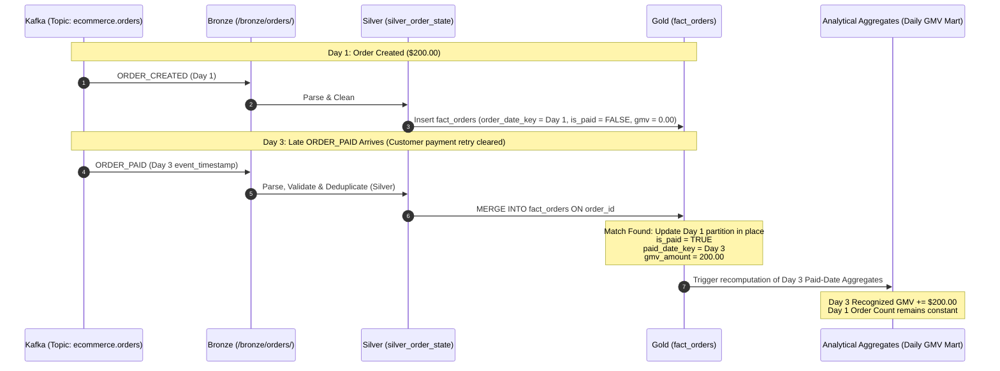
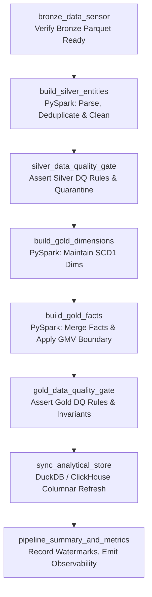

# Data Pipeline Architecture Specification: Real-time E-commerce Analytics Platform

## Document Metadata
- **Project Name:** Real-time E-commerce Analytics Platform
- **Document Phase:** Phase 7 — Data Pipeline Design
- **Document Path:** `docs/07-data-pipeline.md`
- **Upstream Dependencies:**
  - [`docs/01-project-brief.md`](file:///home/nguyen-son-minh/Downloads/Real-time%20E-commerce%20Analytics%20Platform/docs/01-project-brief.md)
  - [`docs/02-requirements.md`](file:///home/nguyen-son-minh/Downloads/Real-time%20E-commerce%20Analytics%20Platform/docs/02-requirements.md)
  - [`docs/03-use-cases.md`](file:///home/nguyen-son-minh/Downloads/Real-time%20E-commerce%20Analytics%20Platform/docs/03-use-cases.md)
  - [`docs/04-system-architecture.md`](file:///home/nguyen-son-minh/Downloads/Real-time%20E-commerce%20Analytics%20Platform/docs/04-system-architecture.md)
  - [`docs/05-database-design.md`](file:///home/nguyen-son-minh/Downloads/Real-time%20E-commerce%20Analytics%20Platform/docs/05-database-design.md)
  - [`docs/06-data-model.md`](file:///home/nguyen-son-minh/Downloads/Real-time%20E-commerce%20Analytics%20Platform/docs/06-data-model.md)
- **Downstream Artifacts:**
  - `docs/08-api-specification.md` (Operational REST Endpoints & Analytical Query Interfaces)
  - Implementation Codebases (Java/Spring Boot Backend, PySpark Pipelines, Airflow DAGs)
- **Design Status:** READY FOR PIPELINE IMPLEMENTATION

---

## 1. Document Purpose & Objectives

### 1.1 Purpose
This document provides the exhaustive **Data Pipeline Architecture & Engineering Design** for the **Real-time E-commerce Analytics Platform**. It operationalizes the analytical dimensional models specified in [`docs/06-data-model.md`](file:///home/nguyen-son-minh/Downloads/Real-time%20E-commerce%20Analytics%20Platform/docs/06-data-model.md) by defining the end-to-end data processing mechanics across the Medallion Lakehouse architecture (Bronze $\rightarrow$ Silver $\rightarrow$ Gold $\rightarrow$ Analytical Store).

### 1.2 Core Engineering Objectives
- **Operational Decoupling:** Guarantee absolute isolation between operational OLTP workloads (PostgreSQL 16) and analytical data processing via asynchronous event propagation (Kafka).
- **Medallion Progression:** Establish explicit contracts for Raw Ingestion (Bronze), Cleansing & Deduplication (Silver), and Dimensional Marts (Gold).
- **Determinism & Idempotency:** Ensure all pipeline tasks can be safely retried, backfilled, or replayed from Bronze without introducing duplicate records or corrupted financial figures.
- **Financial Rigor:** Enforce the authoritative Gross Merchandise Value (GMV) boundary triggered solely by `ORDER_PAID`, decoupling payment attempt audits from commercial revenue recognition.
- **Automated Quality & Governance:** Establish circuit-breaking Data Quality (DQ) gateways that intercept and quarantine malformed records without silently dropping data.
- **Robust Orchestration:** Define modular, dependency-managed Apache Airflow DAGs with watermarking, operational latency monitoring, and automated retry policies.
- **Local Feasibility:** Maintain an engineering footprint optimized for a local developer environment (16 GB RAM) without sacrificing enterprise architectural principles.

---

## 2. Pipeline Scope & Non-Goals

### 2.1 In Scope
- Architectural definition of the near-real-time streaming ingestion daemon (Kafka $\rightarrow$ Bronze).
- Parquet storage layout, partitioning schemas, and metadata tracking across Bronze, Silver, and Gold.
- PySpark transformation specifications for Silver parsing, schema conformance, and windowed deduplication (`event_id`).
- PySpark transformation specifications for Gold dimensional lookups, surrogate key generation, and in-place fact table merges.
- Handling of late-arriving events and multi-partition updates (order-date partition vs. paid-date aggregate rollups).
- Isolation of Silver cart staging/helper datasets from canonical Gold fact tables.
- Data Quality assertion gates, error-handling thresholds, and Dead-Letter Quarantine (`quarantine_events`) specifications.
- Airflow DAG topology, task contracts, scheduling intervals, and backfill mechanics.
- Analytical Store loading abstractions (DuckDB / ClickHouse) reading Gold Parquet.
- 8 End-to-End Pipeline Execution Scenarios covering normal processing, failures, retries, and edge cases.

### 2.2 Out of Scope (Non-Goals)
- Writing physical implementation code (no executable PySpark Python scripts, no production Airflow DAG Python files, no Kafka consumer daemon Java/Python implementations, no Docker Compose YAMLs).
- Direct analytical querying or reporting connections against operational PostgreSQL tables.
- Introducing unapproved technologies (no Apache Flink, no Spark Structured Streaming, no Kafka Streams, no Kubernetes operators, no heavy enterprise lakehouse frameworks like Delta Lake / Apache Iceberg unless adopted as an implementation detail).
- Creating unapproved events (no invented `ORDER_COMPLETED` domain event; no CDC/Debezium infrastructure).
- Redesigning upstream transactional schemas or downstream dimensional models locked in Phase 5 and Phase 6.

---

## 3. Overall Pipeline Architecture (Decoupled Medallion Lakehouse)

### 3.1 Architectural Schematic



### 3.2 Dual-Boundary Processing Model
The pipeline is strictly divided into two distinct processing regimes:

```text
+---------------------------------------------------------------------------------------+
| 1. NEAR-REAL-TIME STREAMING BOUNDARY (Sub-Second to Few Seconds Latency)             |
|    PostgreSQL 16 ──> outbox_events ──> Kafka Topics ──> Ingestion Daemon ──> Bronze  |
+---------------------------------------------------------------------------------------+
                                           │
                                           ▼ (Decoupled Micro-batch / Hourly Boundary)
+---------------------------------------------------------------------------------------+
| 2. SCHEDULED BATCH PROCESSING BOUNDARY (Orchestrated by Apache Airflow 2.8)          |
|    Bronze Parquet ──> Silver PySpark ──> Gold Star Schema ──> Analytical Store (OLAP)|
+---------------------------------------------------------------------------------------+
```

1. **Streaming / Ingestion Boundary:** Event-driven, low-overhead, append-only. Captures transactional state mutations immediately and lands raw JSON payloads into immutable Bronze Parquet files.
2. **Batch / Analytical Boundary:** Set-based, vectorized, compute-intensive. Airflow triggers PySpark jobs on hourly or micro-batch intervals to clean, deduplicate, conform dimensions, calculate GMV, and update Gold Star Schema tables.

---

## 4. Source Systems & Ingestion Boundaries

### 4.1 PostgreSQL 16 OLTP as Single Source of Truth
PostgreSQL 16 is the sole operational source of truth. It manages relational entities in 3NF across 10 core tables:
`users`, `categories`, `products`, `inventory`, `carts`, `cart_items`, `orders`, `order_items`, `payments`, and `outbox_events`.

### 4.2 The Transactional Outbox Pattern
To prevent dual-write inconsistencies (where a database write succeeds but a message broker publish fails, or vice versa), the operational backend executes all state mutations and domain event writes within the **same local ACID database transaction**:

```sql
-- Operational Transaction Boundary Example
BEGIN;
  -- 1. Mutate operational state
  UPDATE orders SET status = 'PAID', updated_at = NOW() WHERE id = :order_id;
  -- 2. Persist outbox event atomically
  INSERT INTO outbox_events (
      id, aggregate_type, aggregate_id, event_type, schema_version, payload, status
  ) VALUES (
      gen_random_uuid(), 'ORDER', :order_id, 'ORDER_PAID', '1.0', :json_payload, 'PENDING'
  );
COMMIT;
```

An independent asynchronous **Outbox Poller Daemon** scans `outbox_events` using `SELECT ... FOR UPDATE SKIP LOCKED`, publishes messages to the appropriate Kafka topics, and marks outbox rows as `PUBLISHED`.

### 4.3 Dimension Ingestion & Controlled Reference Boundaries
For master catalog reference entities (`categories`, `products`) and registered user profiles (`users`), analytical pipelines require dimensional attributes:
- **Controlled Reference Ingestion Dependency:** Reference data flows from the operational store into the data platform via a controlled, bounded reference ingestion staging boundary (`/staging/reference/`).
- **Strict Analytical Isolation:** This reference ingestion path is used only to synchronize dimensional reference data. It is not an analytical query path. BI, dashboards, analytical queries, and Gold fact generation must not directly query PostgreSQL OLTP.

---

## 5. Kafka $\rightarrow$ Bronze Ingestion Daemon

### 5.1 Kafka Topics & Event Topology
The message broker utilizes 5 dedicated topics partitioned by business keys to guarantee partition-level ordering:

| Kafka Topic | Partition Key | Upstream Domain Events Emitted | Partition Count | Target Bronze Directory |
| :--- | :--- | :--- | :--- | :--- |
| `ecommerce.orders` | `order_id` | `ORDER_CREATED`, `ORDER_PAID`, `ORDER_CANCELLED` | 3 | `/bronze/orders/` |
| `ecommerce.payments` | `order_id` | `PAYMENT_COMPLETED`, `PAYMENT_FAILED` | 3 | `/bronze/payments/` |
| `ecommerce.views` | `session_token` | `PRODUCT_VIEWED` | 3 | `/bronze/views/` |
| `ecommerce.users` | `user_id` | `USER_REGISTERED` | 3 | `/bronze/users/` |
| `ecommerce.carts` | `cart_id` | `ITEM_ADDED`, `CART_UPDATED` | 3 | `/bronze/carts/` |

> [!IMPORTANT]
> **No Invented `ORDER_COMPLETED` Event:**
> The upstream event contract defines `ORDER_CREATED`, `ORDER_PAID`, and `ORDER_CANCELLED` for the order domain. The operational state `COMPLETED` is an internal OLTP order lifecycle state, **not an upstream Kafka event**. The pipeline processes only events explicitly defined by the upstream contract.

### 5.2 Canonical Event Envelope
Every event message published to Kafka strictly conforms to the standardized JSON envelope schema (v1.0):

```json
{
  "event_id": "c1f7b9c2-5d82-4e89-9a21-998877665544",
  "event_type": "ORDER_PAID",
  "aggregate_type": "ORDER",
  "aggregate_id": "f47ac10b-58cc-4372-a567-0e02b2c3d479",
  "occurred_at": "2026-09-26T14:30:00.123456Z",
  "schema_version": "1.0",
  "payload": {
    "order_id": "f47ac10b-58cc-4372-a567-0e02b2c3d479",
    "customer_id": "a0eebc99-9c0b-4ef8-bb6d-6bb9bd380a11",
    "total_amount": 149.99,
    "paid_at": "2026-09-26T14:30:00Z"
  }
}
```

### 5.3 Consumer Group Strategy & Micro-batch Buffering
The **Ingestion Daemon** is a lightweight, dedicated consumer service running in the background:
- **Consumer Group:** `lakehouse-bronze-ingestor`
- **Offset Commit Semantics:** `enable.auto.commit = false`. Offsets are committed to Kafka **only after** the current in-memory buffer of records has been successfully flushed and closed on physical Parquet storage (`fsync` / object close).
- **Buffer Flush Criteria:** An active batch file is closed and written to Bronze whenever:
  1. Buffer record count reaches **10,000 records**, OR
  2. Buffer time age reaches **60 seconds** (whichever threshold triggers first).
- **Minimal Envelope Validation Only:** The daemon performs only basic transport/envelope validation (verifying envelope structure, non-empty `event_id`, present `event_type` string, `schema_version`). It does **not** parse JSON payload business attributes, does **not** perform semantic normalization, and does **not** deduplicate. It stores raw payloads as text to preserve maximal ingestion throughput.

### 5.4 Strict Event Semantics: `PAYMENT_COMPLETED` vs. `ORDER_PAID`
The ingestion daemon and downstream consumers enforce absolute semantic discipline:
- **`PAYMENT_COMPLETED`:** Emitted exclusively by the payment service. Certifies that a financial transaction capture attempt succeeded at the payment gateway. Ingested into `/bronze/payments/` $\rightarrow$ destined for `fact_payments`. It **never** alters order status or recognizes GMV.
- **`ORDER_PAID`:** Emitted exclusively by the order domain. Certifies that the commercial order has received full payment confirmation, finalizing the sales contract. Ingested into `/bronze/orders/` $\rightarrow$ destined for `fact_orders`. It is the **sole authoritative trigger for GMV recognition**.

---

## 6. Bronze Layer Design

### 6.1 Raw, Immutable, Append-Only Storage
The Bronze layer acts as the permanent, immutable historical record of all data that entered the platform:
- **Append-Only:** Updates and in-place deletions are physically prohibited.
- **Complete Replayability:** If Silver or Gold tables are corrupted or dimensional models are refactored, the entire analytics platform can be reconstructed from scratch by replaying Bronze files.
- **Preservation of Raw Duplicates:** Duplicate raw ingestion may exist in Bronze by design (due to publisher network retries or consumer group rebalances); canonical deduplication is strictly performed in Silver using `event_id`. Bronze preserves what arrived; Silver determines what is valid and canonical.

### 6.2 Physical Directory & Partitioning Layout
Bronze files are stored in Snappy-compressed Apache Parquet format, partitioned by ingestion date and hour to facilitate clean, incremental time-slice scanning:

```text
/lakehouse/bronze/
├── orders/
│   └── ingestion_date=2026-09-26/
│       ├── hour=14/
│       │   ├── part-0000-tid-orders-14.parquet
│       │   └── part-0001-tid-orders-14.parquet
│       └── hour=15/
│           └── part-0000-tid-orders-15.parquet
├── payments/
│   └── ingestion_date=2026-09-26/
│       └── hour=14/
│           └── part-0000-tid-payments-14.parquet
├── views/
│   └── ingestion_date=2026-09-26/
│       └── hour=14/
│           └── part-0000-tid-views-14.parquet
├── users/
│   └── ingestion_date=2026-09-26/
│       └── hour=14/
│           └── part-0000-tid-users-14.parquet
└── carts/
    └── ingestion_date=2026-09-26/
        └── hour=14/
            └── part-0000-tid-carts-14.parquet
```

### 6.3 Bronze Physical Schema Specification

| Column Name | Data Type | Nullable | Source / Description |
| :--- | :--- | :--- | :--- |
| `raw_payload` | `STRING` | `NOT NULL` | The exact, unmodified JSON string message payload |
| `event_id` | `STRING` | `NOT NULL` | Extracted event UUID from envelope header |
| `event_type` | `STRING` | `NOT NULL` | Event classifier (`ORDER_CREATED`, `ORDER_PAID`, etc.) |
| `aggregate_type` | `STRING` | `NOT NULL` | Domain entity type (`ORDER`, `PAYMENT`, `USER`, etc.) |
| `aggregate_id` | `STRING` | `NOT NULL` | Root entity business UUID |
| `occurred_at` | `TIMESTAMP`| `NOT NULL` | UTC timestamp when event occurred in domain |
| `schema_version` | `STRING` | `NOT NULL` | Version string (`'1.0'`) |
| `kafka_topic` | `STRING` | `NOT NULL` | Source Kafka topic name |
| `kafka_partition`| `INTEGER` | `NOT NULL` | Source Kafka partition index |
| `kafka_offset` | `BIGINT` | `NOT NULL` | Source Kafka message offset |
| `ingested_at` | `TIMESTAMP`| `NOT NULL` | Precise UTC timestamp of file write |
| `ingestion_date` | `DATE` | `NOT NULL` | Partition key derived from `ingested_at` (`YYYY-MM-DD`) |
| `hour` | `INTEGER` | `NOT NULL` | Partition key derived from `ingested_at` (`0` to `23`) |

---

## 7. Bronze $\rightarrow$ Silver Transformation Pipeline

### 7.1 PySpark Processing Paradigm
Bronze $\rightarrow$ Silver processing is executed as an incremental, scheduled batch job orchestrated by Airflow. It reads a bounded slice of Bronze data (e.g., the previous hour's ingestion partitions), applies parsing and quality rules, deduplicates records, and commits clean datasets to Silver.

```text
  [Bronze Raw Parquet]
           │
           ▼
  [Step 1: Ingestion Slice Reader]       Filter: ingestion_date = :date AND hour = :hour
           │
           ▼
  [Step 2: JSON Schema Parsing]          Unpack raw_payload into strongly typed columns
           │
           ▼
  [Step 3: Data Quality Gateway]         Validate schemas, types, invariants, non-nulls
          ├──> Corrupted Records ──────> Route to Quarantine Storage (/quarantine/)
          │
          ▼ (Valid Records Only)
  [Step 4: Windowed Deduplication]       ROW_NUMBER() OVER (PARTITION BY event_id ORDER BY ingestion_timestamp ASC)
           │
           ▼
  [Step 5: Silver Atomic Merge/Write]    Commit deduplicated entity logs partitioned by event_date
```

### 7.2 Schema Parsing & Strict Type Coercion
Using PySpark's explicit `from_json()` with predefined StructTypes, raw JSON text is coerced into strongly typed primitives:
- UUIDs are verified against valid 128-bit hexadecimal format consistent with the upstream identifier strategy (valid standard UUID string format).
- Timestamps are normalized to UTC `TIMESTAMPTZ`.
- Monetary amounts are parsed into exact `DECIMAL(12,2)`. Floating point types (`FLOAT`, `DOUBLE`) are strictly forbidden to eliminate rounding errors in financial reporting.

---

## 8. Silver Deduplication Mechanics

### 8.1 The Canonical Deduplication Key: `event_id`
In a distributed event system, message duplication can occur at the publisher (network timeouts triggering retries) or consumer (offset commit failures).
- **The Primary Deduplication Key:** The **`event_id`** (UUID) assigned at domain creation time inside PostgreSQL `outbox_events` is the unique identity of the event.
- **Forbidden Deduplication Strategies:** Pipelines must **never** deduplicate by timestamp or payload hash, as distinct business events (e.g., two identical \$10 clickstream actions) could share identical timestamps or payloads.

### 8.2 PySpark Deduplication Logic
During the Silver job, deduplication is enforced deterministically across the processing window and existing Silver partitions:

```sql
-- Conceptual Deduplication Transformation
WITH WindowedEvents AS (
    SELECT 
        *,
        ROW_NUMBER() OVER (
            PARTITION BY event_id 
            ORDER BY ingestion_timestamp ASC, kafka_offset ASC
        ) as ranking
    FROM bronze_input_slice
)
SELECT * 
    FROM WindowedEvents 
WHERE ranking = 1;
```

### 8.3 Invariant: Bronze vs. Silver
- **Bronze:** Duplicate raw ingestion may exist in Bronze by design; Bronze preserves what arrived for audit and replay.
- **Silver:** Every valid `event_id` appears **exactly once** in the canonical cleansed Silver event tables. Silver determines what is valid and canonical.

---

## 9. Silver Datasets Specification

Silver datasets are structured into strongly typed, normalized Parquet tables partitioned by **`event_date`** (`DATE(occurred_at)`).

### 9.1 Canonical Silver Entities

| Silver Table Name | Source Events Ingested | Primary Natural Key | Description / Purpose |
| :--- | :--- | :--- | :--- |
| `silver_orders` | `ORDER_CREATED` | `order_id` | Master order header records with customer and gross amounts |
| `silver_order_items` | `ORDER_CREATED` | `order_item_id` | Individual order line items with snapshotted prices and quantities (grain: 1 row / source order item) |
| `silver_order_state` | `ORDER_PAID`, `ORDER_CANCELLED` | `(order_id, event_type)` | Order lifecycle mutations tracking transitions to `PAID` or `CANCELLED` |
| `silver_payments` | `PAYMENT_COMPLETED`, `PAYMENT_FAILED`| `payment_id` | Individual payment gateway transaction attempts |
| `silver_product_views`| `PRODUCT_VIEWED` | `event_id` | Cleaned clickstream product impression events |
| `silver_customers` | `USER_REGISTERED` | `customer_id` | Cleaned customer master records |
| `silver_products` | *(Controlled Ref Ingest)* | `product_id` | Product catalog master records with current pricing |
| `silver_categories` | *(Controlled Ref Ingest)* | `category_id` | Product category taxonomy master records |

### 9.2 Silver Cart Helper / Staging Datasets (Funnel Analytics)
- **`silver_cart_items` & `silver_cart_events`:** Ingested from `ITEM_ADDED` and `CART_UPDATED`.
- **Strict Architectural Boundary:** Cart datasets are **Silver staging and analytical helper datasets** used exclusively for conversion funnel drop-off analytics. They **do not** form part of the canonical Gold Star Schema fact tables.
- **Conversion Metric Semantic Boundary:** Conversion funnel metrics (such as the View-to-Unit-Purchase Ratio) are defined as aggregate ratios ($\frac{\sum \text{quantity}}{\sum \text{view\_count}}$), not as user-level attributed session funnels.

---

## 10. Silver $\rightarrow$ Gold Transformation Pipeline

### 10.1 Processing Pipeline Stages
The Silver $\rightarrow$ Gold pipeline transforms normalized entity logs into the Kimball Star Schema. It executes as a scheduled PySpark batch job operating over the incremental Silver window:

```text
  [Silver Incremental Datasets]
                │
                ▼
  [Step 1: Dimensional Entity Maintenance] ──> Upsert SCD Type 1 Dimensions (dim_customers, dim_products, dim_categories)
                │
                ▼
  [Step 2: Surrogate Key Resolution]        ──> Join Conformed Dimensions; assign stable integer keys (fallback to -1)
                │
                ▼
  [Step 3: Business Invariant Evaluation]   ──> Apply authoritative GMV rules (ORDER_PAID sole causal trigger)
                │
                ▼
  [Step 4: Fact Assembly & Price Snapshot]  ──> Freeze unit_price_snapshot in fact_order_items from order creation payload
                │
                ▼
  [Step 5: Idempotent Atomic Merge]         ──> MERGE into Gold Fact Parquet tables using primary natural keys
```

### 10.2 Dimensional Lookup & Surrogate Key Generation
- Dimensions are looked up using primary natural business keys:
  - `silver_customers.customer_id` $\rightarrow$ `dim_customers.customer_key`
  - `silver_products.product_id` $\rightarrow$ `dim_products.product_key`
  - `silver_categories.category_id` $\rightarrow$ `dim_categories.category_key`
  - `DATE(occurred_at)` $\rightarrow$ `dim_date.date_key`
  - `silver_orders.status` $\rightarrow$ `dim_order_status.status_key`
- **Fallback Resolution:** Unmatched foreign keys (e.g., guest clickstream events without a registered user account) resolve deterministically to `-1: Anonymous Guest` or `-2: Not Applicable`, preserving foreign key integrity without halting jobs.

---

## 11. Gold Layer Architecture

### 11.1 Conformed Dimensions & Canonical Facts
The Gold analytical layer conforms strictly to the dimensional schema locked in [`docs/06-data-model.md`](file:///home/nguyen-son-minh/Downloads/Real-time%20E-commerce%20Analytics%20Platform/docs/06-data-model.md):

```text
CONFORMED DIMENSIONS (5 Tables):
├── dim_date           (Grain: 1 row / calendar day, 2024-2030 pre-populated)
├── dim_customers      (Grain: 1 row / customer, SCD Type 1, guest sentinel -1)
├── dim_products       (Grain: 1 row / product catalog item, SCD Type 1)
├── dim_categories     (Grain: 1 row / category, SCD Type 1)
└── dim_order_status   (Grain: 1 row / lifecycle status, static 5 rows)

CANONICAL FACT TABLES (4 Tables):
├── fact_orders        (Grain: 1 row / order entity; GMV boundary)
├── fact_order_items   (Grain: 1 row / line item; immutable price snapshots)
├── fact_payments      (Grain: 1 row / payment attempt; multi-attempt audit)
└── fact_product_views (Grain: 1 row / clickstream view; guest support)
```

### 11.2 Storage Format & Partitioning Keys
- **Physical Format:** Snappy-compressed Apache Parquet with dictionary and run-length encoding.
- **Partitioning Strategy:**
  - `fact_orders`: Partitioned by `order_date_key` (`YYYYMMDD`).
  - `fact_order_items`: Partitioned by `order_date_key` (`YYYYMMDD`).
  - `fact_payments`: Partitioned by `payment_date_key` (`YYYYMMDD`).
  - `fact_product_views`: Partitioned by `date_key` (`YYYYMMDD`).
  - Dimensions: Unpartitioned (compact, cached in memory for sub-second vector joins).

---

## 12. Fact Grain Enforcement & Lifecycle In-Place Updates

### 12.1 Mathematical Grain Invariants

| Fact Table | Declared Atomic Grain | Natural Business Key | Gold Surrogate PK | Cardinality Rule |
| :--- | :--- | :--- | :--- | :--- |
| `fact_orders` | **One row per order** | `order_id` (`UUID`) | `order_key` (`BIGINT`) | Exactly 1 physical row per commercial order entity |
| `fact_order_items`| **One row per source order item** | `order_item_id` (`UUID`) | `order_item_key` (`BIGINT`) | 1 to N rows per order (`order_id` & `product_id` are dimension FKs) |
| `fact_payments` | **One row per attempt** | `payment_id` (`UUID`) | `payment_key` (`BIGINT`) | 1 to M rows per order (multi-attempt audit) |
| `fact_product_views`| **One row per view event** | `event_id` (`UUID`) | `view_key` (`BIGINT`) | 1 row per clickstream impression |

### 12.2 Lifecycle In-Place Updates on `fact_orders`
In naive data warehouses, each order lifecycle event appends a new row, leading to massive fan-out traps during query aggregation. This pipeline enforces **In-Place Updates via Natural Key Merging on `order_id`**:
- When `ORDER_CREATED` is processed: Inserts initial row into `fact_orders` (`status_key = 1 (PENDING)`, `is_paid = FALSE`, `gmv_amount = 0.00`).
- When `PAYMENT_FAILED` is processed: Updates the existing row (`status_key = 3 (PAYMENT_FAILED)`, `is_paid = FALSE`, `gmv_amount = 0.00`).
- When `ORDER_PAID` is processed: Updates the existing row (`status_key = 2 (PAID)`, `is_paid = TRUE`, `gmv_amount = total_amount`, `paid_date_key = DATE(event_timestamp)`).
- When `ORDER_CANCELLED` is processed: Updates the existing row (`status_key = 4 (CANCELLED)`, `cancelled_at = event_timestamp`).
- **Status of `COMPLETED` in the Analytics Pipeline:**
  - `COMPLETED` is a valid terminal business state in the OLTP order lifecycle (`PAID -> COMPLETED`), but it is not currently a defined analytics event source in the MVP pipeline.
  - The analytics pipeline processes only events explicitly defined by the upstream event contract (`ORDER_CREATED`, `ORDER_PAID`, `ORDER_CANCELLED`, `PAYMENT_COMPLETED`, `PAYMENT_FAILED`, clickstream events).
  - Completion-state analytics can be added later when an explicit source or upstream contract is introduced.
  - In the MVP analytics pipeline, an order that successfully confirms payment reaches and remains in `PAID` status (`status_key = 2`) with full GMV recognized in `fact_orders`. No unapproved `ORDER_COMPLETED` event, operational change feed, CDC connector, or Debezium system is assumed or invented.
- **Core Law:** Order lifecycle progression **never** appends a duplicate row to `fact_orders`.

---

## 13. Authoritative GMV Pipeline

### 13.1 The Canonical GMV Invariant
Gross Merchandise Value (GMV) is the single most critical commercial metric in the e-commerce business. The pipeline enforces the following canonical invariant:

```text
ORDER_PAID is the authoritative commercial event for GMV recognition.

PAID is an order state; COMPLETED is an OLTP lifecycle state.
They are not independent GMV recognition events.

A replay, duplicate ORDER_PAID, PAYMENT_COMPLETED,
or later state mutation must never create additional GMV.
```

### 13.2 Formal GMV Materialization & Causal Semantics
Gross Merchandise Value recognition strictly obeys a deterministic causal progression:

```text
ORDER_PAID (Authoritative Commercial Event)
    ↓
is_paid = TRUE (Internal Order State Updated)
    ↓
gmv_amount = total_amount (Commercial Revenue Recognized)
```

The semantics are defined as follows:
- **`ORDER_PAID`:** The sole authoritative commercial event that confirms a sales contract and triggers revenue recognition.
- **`PAYMENT_COMPLETED`:** Emitted by the payment gateway service to record technical capture success; populated into `fact_payments` for gateway reliability audit only. It does not trigger GMV.
- **`is_paid`:** A state column updated to `TRUE` if and only if `ORDER_PAID` has been successfully processed. It is never an independent event source.
- **`gmv_amount`:** Set equal to `total_amount` upon processing `ORDER_PAID`.

#### Authoritative Invariant:
- **If `ORDER_PAID` has been successfully processed:**
  $$\text{is\_paid} = \text{TRUE} \implies \text{gmv\_amount} = \text{total\_amount}$$
- **If `ORDER_PAID` has not been processed:**
  $$\text{is\_paid} = \text{FALSE} \implies \text{gmv\_amount} = 0.00$$

Prior to or in the absence of `ORDER_PAID`, commercial GMV recognition is strictly `0.00`. Neither `PAYMENT_COMPLETED` nor downstream order states can independently synthesize GMV.

### 13.3 Decoupling `PAYMENT_COMPLETED` from GMV
- `PAYMENT_COMPLETED` records an operational infrastructure success in `fact_payments`. It indicates that the financial gateway captured funds.
- `ORDER_PAID` records a commercial contract transition in `fact_orders`. It indicates that order fulfillment is authorized and commercial revenue is recognized.

### 13.4 Multi-Attempt Payment Retry Scenario
To demonstrate financial correctness under failure recovery, consider an order with a retry:

```text
Timeline of Events for Order #ORD-999 ($150.00):
T1: ORDER_CREATED         ──> fact_orders (status = PENDING, is_paid = FALSE, gmv_amount = 0.00)
T2: PAYMENT_FAILED (At 1) ──> fact_payments (attempt 1, status = FAILED)
                          ──> fact_orders (status = PAYMENT_FAILED, is_paid = FALSE, gmv_amount = 0.00)
T3: PAYMENT_COMPLETED(At 2)──> fact_payments (attempt 2, status = SUCCESS)  [NO GMV RECOGNIZED HERE]
T4: ORDER_PAID            ──> fact_orders (status = PAID, is_paid = TRUE, gmv_amount = 150.00)
```

- **Audit Reality:** `fact_payments` contains **2 physical rows** (attempt 1 FAILED, attempt 2 SUCCESS), providing complete visibility into gateway reliability.
- **Commercial Reality:** `fact_orders` contains **1 physical row** with `gmv_amount = 150.00`. GMV is recognized **exactly once**.
- *Note:* In the operational OLTP database, order fulfillment subsequently transitions the order to `COMPLETED`. Because `COMPLETED` is not a defined event in the MVP upstream event contract, `fact_orders` maintains the authoritative `PAID` state where GMV was recognized.

---

## 14. Late-Arriving Data & Out-of-Order Processing

### 14.1 The Sequence of Late `ORDER_PAID`



### 14.2 Multi-Partition Impact & Pipeline Policy
When a late-arriving `ORDER_PAID` event arrives:
1. **Target Row Matching:** The pipeline uses `order_id` to locate the existing fact record in `fact_orders`.
2. **Order-Date Partition Update:** The physical partition where the order was created (`order_date_key`) is updated in place (`is_paid = TRUE`, `gmv_amount = total_amount`, `paid_date_key = DATE(event_timestamp)`).
3. **Paid-Date Reporting Aggregates:** Analytical rollups tracking recognized commercial GMV by payment date (`paid_date_key`) must include this order in the reporting window of the payment date, not the creation date.
4. **Idempotency Guarantee:** Rerunning the batch job does not append duplicate rows or re-trigger GMV recognition.

---

## 15. Product Merchandise Sales vs. Order-Level GMV Semantics

To prevent metric confusion and accounting discrepancies, the pipeline enforces strict semantic definitions across all transformation steps:

### 15.1 Order-Level GMV
- **Source:** `fact_orders.gmv_amount`
- **Definition:** Total financial value committed by the customer on paid orders:
  $$\text{Order GMV} = \text{subtotal\_amount} + \text{tax\_amount} + \text{shipping\_amount} \quad (\text{WHERE } \text{is\_paid} = \text{TRUE})$$

### 15.2 Product Merchandise Sales
- **Source:** `fact_order_items.line_total_amount`
- **Definition:** Pure merchandise sales revenue allocated to individual product lines:
  $$\text{Product Merchandise Sales} = \sum (\text{unit\_price\_snapshot} \times \text{quantity}) \quad (\text{WHERE } \text{fact\_orders.is\_paid} = \text{TRUE})$$
- **Distinction Law:** Product and Category reporting must **never** equate `Product Merchandise Sales` with `Order-Level GMV` because sales tax and shipping fees are calculated at the order envelope level, not per line item.

---

## 16. Dimension Maintenance & SCD Type 1 Implementation

### 16.1 In-Place Overwrite Policy
The platform standardizes on **SCD Type 1 (In-Place Overwrite)** across all Gold dimensions for the MVP (`dim_customers`, `dim_products`, `dim_categories`).
- When a customer updates their name or email, `dim_customers` updates in place.
- When a product's catalog title or current price changes, `dim_products` updates in place.
- When a category name changes, `dim_categories` updates in place.

### 16.2 Historical Protection via Fact Snapshots
- **The Guarantee:** Historical monetary calculations are 100% insulated from catalog price changes because `fact_order_items` stores immutable snapshots (`unit_price_snapshot`, `product_sku_snapshot`, `product_title_snapshot`) captured directly from the order creation transaction. Current product catalog attributes never overwrite historical line item snapshots.
- **Documented Limitation:** Category reorganization is intentionally subject to SCD Type 1 limitations. If Product X is moved from *"Electronics"* to *"Accessories"*, historical sales volume for Product X will roll up into *"Accessories"* under current category joins.

---

## 17. Surrogate Key Resolution Strategy

### 17.1 Deterministic & Rebuild-Safe Key Generation
To prevent surrogate keys from shifting after pipeline restarts or historical backfills, surrogate keys are managed via **Persistent Deterministic Key Registries**:
- **Date Dimension:** Surrogate key is mathematically deterministic: `date_key = YYYYMMDD` (`INTEGER`).
- **Customer Dimension:** Operational `customer_id` (`UUID`) maps to an incrementing `customer_key` (`BIGINT`) stored in a persistent lookup mapping table. Once assigned, `customer_key` is immutable and rebuild-safe.
- **Product Dimension:** Operational `product_id` (`UUID`) maps to an immutable `product_key` (`BIGINT`).
- **Category Dimension:** Operational `category_id` (`UUID`) maps to an immutable `category_key` (`BIGINT`).
- **Order Status Dimension:** Static enumeration (`1: PENDING`, `2: PAID`, `3: PAYMENT_FAILED`, `4: CANCELLED`, `5: COMPLETED`).
- **Guest / Unmatched Sentinel:** Guest clickstream interactions are deterministically assigned `customer_key = -1` (`Anonymous Guest`).

---

## 18. Incremental Processing & Watermarking

### 18.1 Ingestion Watermarks & High-Watermark Tracking
The pipeline tracks execution progress using a lightweight **Pipeline Metadata Ledger** (`pipeline_run_metadata`):

```text
Incremental Execution Loop:
1. Query High-Watermark:
   SELECT MAX(watermark_timestamp) FROM pipeline_run_metadata WHERE pipeline_name = 'silver_orders';
2. Define Window:
   start_window = high_watermark
   end_window   = current_execution_time - safety_lag_buffer (5 minutes)
3. Scan Bronze:
   SELECT * FROM bronze_orders WHERE ingested_at >= start_window AND ingested_at < end_window;
4. Transform, Validate, Deduplicate, Commit Silver.
5. Update Ledger:
   INSERT INTO pipeline_run_metadata (pipeline_name, watermark_timestamp, records_processed, status)
   VALUES ('silver_orders', end_window, :count, 'SUCCESS');
```

### 18.2 Watermarking Policies for Run Types
- **Normal Scheduled Run:** Processes `[watermark, execution_date - 5 minutes]`. The 5-minute safety lag buffer accounts for clock drift and in-flight Kafka flushes.
- **Retry Run:** When a task fails, Airflow re-executes the exact same input window. Because Silver and Gold jobs use natural key merges, retries are strictly idempotent.
- **Historical Backfill Run:** Overrides the automated watermark with an explicit historical window `[backfill_start, backfill_end]`, reprocessing partitions deterministically without advancing production watermarks.

---

## 19. Partitioning Strategy across Layers

### 19.1 Layer-Specific Partitioning Policies
Partitioning controls physical data distribution across directories to prune scan volumes and optimize query performance:

| Lakehouse Layer | Partitioning Key | Directory Layout Example | Engineering Justification |
| :--- | :--- | :--- | :--- |
| **Bronze** | `ingestion_date`, `hour` | `/bronze/orders/ingestion_date=2026-09-26/hour=14/` | Aligns with streaming daemon file closes; isolates incoming data slices; completely immune to late-arriving event partition explosion. |
| **Silver** | `event_date` (`DATE(occurred_at)`) | `/silver/orders/event_date=2026-09-26/` | Organizes cleansed entity data by business occurrence date; enables efficient time-slice filtering for downstream fact transformations. |
| **Gold Facts** | `date_key` / `order_date_key` (`YYYYMMDD`) | `/gold/fact_orders/order_date_key=20260926/` | Matches reporting queries joining on `dim_date.date_key`; enables fast partition pruning during analytical aggregation. |
| **Gold Dimensions**| *Unpartitioned* | `/gold/dim_products/` | Compact dimension tables (< 100,000 rows); partitioning would create small-file I/O thrashing. Cached directly in memory during PySpark jobs. |

---

## 20. Data Quality (DQ) Gateways & Automated Assertions

### 20.1 Quality Gate Topology: Strict Layer Decoupling
To eliminate ambiguity between ingestion transport and analytical cleansing, quality verification is strictly decoupled across tiers:

```text
  [Kafka Messages]
         │
         ▼
  [GATEWAY 1: Bronze Transport / Envelope Validation]  ──> Minimal storage validation; preserve raw stream
         │
         ▼
  [GATEWAY 2: Silver Cleansing & Business DQ]          ──> Deep schema parsing, strong typing, dedup, quarantine
         │
         ▼
  [GATEWAY 3: Gold Dimensional Invariant DQ]           ──> Grain uniqueness, foreign key integrity, GMV causal invariants
```

### 20.2 Gateway 1: Bronze Transport & Envelope Validation
Bronze represents the raw arrival record. It performs **only minimal transport/envelope validation** required to ensure the message can be physically stored on disk:
- Message is non-empty and contains storable string/binary payload.
- `event_id` exists in the envelope header.
- `event_type` string is present.
- `schema_version` is present.
- Source Kafka metadata (`kafka_topic`, `kafka_partition`, `kafka_offset`, `ingested_at`) is successfully attached.
- **Strict Ingestion Rule:** Bronze does **NOT** perform business validation, semantic normalization, payload attribute inspection, deep type coercion, or deduplication. Bronze preserves what arrived.

### 20.3 Gateway 2: Silver Cleansing & Business Assertions
Silver is the authoritative boundary where raw data is converted into canonical, validated entities:
- **Payload Parsing:** Unpacks raw JSON text into strongly typed columns using explicit StructTypes.
- **Identifier Validation:** Verifies that entity IDs conform to valid UUID string format consistent with the upstream identifier strategy.
- **Canonical Deduplication:** Enforces `ROW_NUMBER() OVER (PARTITION BY event_id ORDER BY ingestion_timestamp ASC) = 1`.
- **Domain & Boundary Invariants:**
  - Order items: `quantity > 0 AND quantity <= 100`.
  - Financial values: `subtotal_amount >= 0.00`, `tax_amount >= 0.00`, `shipping_amount >= 0.00`, `total_amount >= 0.00`.
  - Payment attempts: `attempt_number >= 1`, `status IN ('SUCCESS', 'FAILED')`, `currency = 'USD'`.
- **Quarantine Action:** Records failing Gateway 2 are not silently dropped; they are serialized into `/quarantine/`.

### 20.4 Gateway 3: Gold Dimensional Invariant Assertions
Gold validates structural integrity across dimensional models:
- **Grain Uniqueness:** Exactly 1 row per `order_id` in `fact_orders`; 1 row per `order_item_id` in `fact_order_items`; 1 row per `payment_id` in `fact_payments`.
- **Financial Balance Invariant:**
  $$\text{total\_amount} = \text{subtotal\_amount} + \text{tax\_amount} + \text{shipping\_amount}$$
- **Authoritative GMV Causal Invariant:**
  $$\begin{cases} 
  \text{If } \text{ORDER\_PAID} \text{ has been successfully processed:} & \text{is\_paid} = \text{TRUE} \implies \text{gmv\_amount} = \text{total\_amount} \\ 
  \text{If } \text{ORDER\_PAID} \text{ has not been processed:} & \text{is\_paid} = \text{FALSE} \implies \text{gmv\_amount} = 0.00 
  \end{cases}$$
  The column `is_paid` is updated exclusively upon processing `ORDER_PAID`; it is never an independent event source or synthesis trigger.
- **Foreign Key Completeness:** All dimension foreign keys resolve to a valid dimension key (or `-1: Anonymous Guest / Unknown`).

---

## 21. Error Handling & Quarantine Dead-Letter Architecture

### 21.1 The Zero-Silent-Drop Policy
Under no circumstances are corrupted or malformed records silently discarded. Any message failing Data Quality Gateways is routed to the **Dead-Letter Quarantine Storage**.

### 21.2 Quarantine Schema Specification (`quarantine_events`)

```text
/lakehouse/quarantine/
└── entity=orders/
    └── year=2026/month=09/day=26/
        └── part-0000-quarantine.parquet
```

| Column Name | Data Type | Nullable | Description |
| :--- | :--- | :--- | :--- |
| `quarantine_id` | `STRING` | `NOT NULL` | Unique tracking UUID generated at quarantine routing |
| `event_id` | `STRING` | `NULL` | Original event UUID (if parseable) |
| `event_type` | `STRING` | `NULL` | Upstream event type |
| `raw_payload` | `STRING` | `NOT NULL` | Complete, unmodified raw message text |
| `failure_stage` | `STRING` | `NOT NULL` | Pipeline stage (`'SILVER_PARSING'`, `'SILVER_DQ'`, `'GOLD_MERGE'`) |
| `failed_rule` | `STRING` | `NOT NULL` | Identification of violated assertion (e.g., `'TOTAL_MATH_MISMATCH'`) |
| `failure_reason`| `STRING` | `NOT NULL` | Human-readable explanation and error stack trace |
| `detected_at` | `TIMESTAMP`| `NOT NULL` | UTC timestamp of quarantine capture |
| `pipeline_run_id`| `STRING` | `NOT NULL` | Orchestrating Airflow DAG run identifier |

### 21.3 Triage, Alerting & Replay Procedure
- **P2 Alert Trigger:** If quarantined records exceed **0.1%** of the batch volume, the pipeline task fails immediately and sends an automated alert to the engineering on-call channel.
- **Forensic Triage:** Engineers inspect `quarantine_events` to determine whether failures stem from upstream application bugs or unexpected schema drift.
- **Replay Mechanism:** Once bugs are resolved, a dedicated Airflow backfill task re-reads the quarantined payloads, re-submits them through the Silver cleansing pipeline, and atomically merges the corrected data into downstream tables.

---

## 22. Pipeline Retry, Idempotency & Fault Tolerance

### 22.1 Layered Natural & Idempotency Keys
The pipeline achieves mathematical idempotency across all stages by operating strictly on deterministic natural keys:

| Pipeline Stage | Entity Scope | Idempotency Key | Write Semantic | Rerun Impact |
| :--- | :--- | :--- | :--- | :--- |
| **Bronze** | Raw Ingest | `kafka_topic + partition + offset` | Append-only partition commit | Duplicate raw ingestion may exist in Bronze by design; canonical deduplication is performed in Silver using `event_id` |
| **Silver** | Clean Events | `event_id` | Windowed `ROW_NUMBER() = 1` | Deterministic deduplicated output |
| **Gold Orders** | `fact_orders` | `order_id` | `MERGE target USING source ON target.order_id` | Existing row updated in place; zero duplicate rows |
| **Gold Items** | `fact_order_items`| `order_item_id` | `MERGE target USING source ON target.order_item_id` | Line items updated in place; zero duplicate lines |
| **Gold Payments**| `fact_payments` | `payment_id` | `MERGE target USING source ON target.payment_id`| Attempt audit updated in place; zero duplicates |
| **Gold Views** | `fact_product_views`| `event_id` | Partition Overwrite on `event_id` | Clickstream slice rewritten; zero duplicates |

### 22.2 Safe Task Retries in Apache Airflow
Because every write operation in Silver and Gold uses either deterministic partition overwrites or SQL `MERGE` statements keyed by immutable natural IDs:
- If an Airflow task crashes midway due to an infrastructure outage (e.g., worker node spot eviction), Airflow simply restarts the task.
- The restarted job processes the same input window and overwrites/merges cleanly.
- No partial writes, duplicate financial figures, or ghost rows are left behind.

---

## 23. Backfill & Historical Replay Framework

### 23.1 The Replay Principle
The immutability of the Bronze layer guarantees that the analytics platform can be completely reconstructed from historical raw events.

```text
                               HISTORICAL REPLAY FLOW
+-----------------------------------------------------------------------------------+
| 1. Purge Downstream: Drop or clear Silver/Gold partitions for [Start_Date, End_Date]|
| 2. Parameterize Airflow: Trigger backfill DAG with execution_date range           |
| 3. Read Bronze Parquet: Scan immutable raw events for historical time window      |
| 4. Reprocess Silver: Clean, re-parse schemas, and deduplicate on event_id         |
| 5. Rebuild Gold Marts: Re-resolve surrogate keys, recompute GMV, and commit Gold  |
| 6. Re-sync Analytical Store: Refresh columnar views in DuckDB / ClickHouse        |
+-----------------------------------------------------------------------------------+
```

### 23.2 Backfill Safety Guarantees
- **Partition Bounding:** Backfills operate strictly within parameterized date boundaries, preventing accidental mutations to current active production partitions.
- **Isolated Run Metadata:** Backfill executions record unique `pipeline_run_id` tags in `pipeline_run_metadata` with `run_type = 'BACKFILL'`, preventing automated production watermarks from skipping unread data.

---

## 24. Airflow DAG Orchestration Design

### 24.1 DAG Topology (`flowchart TD`)



### 24.2 DAG Configuration & Scheduling Parameters
- **DAG Identifier:** `ecommerce_analytics_hourly_pipeline`
- **Schedule Interval:** `@hourly` (triggered at minute 5 past every hour: `05 * * * *`).
- **Catchup Policy:** `catchup = false` for automated production; parameterized backfills enabled via manual CLI runs.
- **Concurrency & Parallelism:** `max_active_runs = 1` (prevents overlapping writes to identical physical partitions).
- **Default Task Retries:** `retries = 3`, `retry_delay = timedelta(minutes=5)`, `retry_exponential_backoff = true`.
- **Operational Execution Alert Threshold:** Pipeline execution duration exceeding **30 minutes** triggers an alert notification.

---

## 25. Airflow Task Detailed Specifications

### 25.1 Task Contract Matrix

| Task Identifier | Core Responsibility | Input Dataset | Output Dataset | Idempotency Mechanism | Failure & Alert Policy |
| :--- | :--- | :--- | :--- | :--- | :--- |
| `bronze_data_sensor` | Verifies that the previous hour's Bronze Parquet files are closed and available on storage | `/bronze/*/ingestion_date=.../hour=.../` | Sensor Confirmation | Read-only check | Soft failure with sensor poke timeout (15 mins) |
| `build_silver_entities` | Unpacks raw JSON, casts strong types, cleans strings, deduplicates on `event_id` | Bronze input hourly slice | `/silver/*/event_date=.../` | Dynamic partition overwrite on `event_date` | 3 retries with exponential backoff; halts DAG on final failure |
| `silver_data_quality_gate` | Executes DQ assertions on Silver; routes invalid records to `/quarantine/` | `/silver/*/` | DQ Validation Report / Quarantine Files | Idempotent scan and quarantine write | Fails task if quarantine rate > 0.1%; triggers alert |
| `build_gold_dimensions` | Maintains conformed dimensions; performs SCD Type 1 in-place overwrites; resolves surrogate keys | `/silver/customers`, `/products`, `/categories` | `/gold/dim_*/` | Natural key merge on `customer_id`, `product_id`, `category_id` | 3 retries; halts DAG on failure |
| `build_gold_facts` | Assembles canonical facts; freezes historical item snapshots; evaluates `ORDER_PAID` GMV | `/silver/orders`, `/order_items`, `/payments`, `/views` | `/gold/fact_*/` | Idempotent natural key MERGE on `order_id`, `order_item_id`, `payment_id`, `event_id` | 3 retries; halts DAG on failure |
| `gold_data_quality_gate` | Verifies grain uniqueness, financial math (`total = subtotal + tax + ship`), GMV boundary | `/gold/fact_*/` | Gold DQ Validation Ledger | Read-only assertions | Fatal halt if financial math or GMV rules fail |
| `sync_analytical_store` | Updates columnar tables or views in DuckDB / ClickHouse from Gold Parquet | `/gold/*/` | Analytical Store Tables / Catalog | Overwrite / atomic view switch | 3 retries; triggers alert on connectivity loss |
| `pipeline_summary_and_metrics` | Updates `pipeline_run_metadata` high-watermark, computes batch throughput, records execution logs | Task execution state | `pipeline_run_metadata` | Primary key upsert on `pipeline_run_id` | Non-fatal logging alert |

---

## 26. Streaming vs. Batch Boundary Rationale

### 26.1 Architectural Decoupling Justification
The decision to implement near-real-time streaming for Bronze ingestion and scheduled batch processing for Silver/Gold is grounded in solid data engineering trade-offs:
1. **Separation of Concerns:** Ingestion must never crash because of downstream schema or business rule errors. Streaming ingestion focuses exclusively on raw byte throughput and persistence.
2. **Batch Efficiency for Dimensional Modeling:** Kimball dimensional modeling relies on multi-table joins, surrogate key lookups, and global window deduplications. These operations are significantly more efficient, deterministic, and resource-effective when executed as set-based vectorized batch jobs in PySpark rather than stateful streaming micro-aggregations.
3. **Local Developer Feasibility (16 GB RAM):** Running continuous 24/7 streaming engines (like Spark Streaming or Apache Flink) consumes substantial baseline JVM memory and CPU cycles even when idle. A scheduled batch model releases memory immediately after job completion, guaranteeing deterministic execution on a single 16 GB laptop without container OOM crashes.

---

## 27. Schema Evolution & Versioning Strategy

### 27.1 Evolution Governance
Events conform to a semantic version string (`schema_version = "1.0"`).
- **Backward-Compatible Changes (Additive):** New fields may be added to an event payload (e.g., adding `discount_code` to `ORDER_CREATED`). PySpark schemas handle additive fields gracefully by reading them as nullable columns without breaking existing pipelines.
- **Breaking Changes:** Modifications such as renaming fields, altering data types, or deleting mandatory fields require bumping the major version (`schema_version = "2.0"`).
- **Bronze Raw Preservation:** Because Bronze stores the raw JSON text unconditionally, historical records can always be reparsed using updated schema definitions if backward-compatibility adapters are introduced in Silver.
- **Schema Registry Note:** While enterprise production deployments often utilize a centralized Schema Registry (e.g., Confluent / Karapace), this MVP maintains schema definitions directly within the PySpark StructType code to minimize operational infrastructure overhead.

---

## 28. End-to-End Data Lineage

### 28.1 Core Lineage Tracing Matrix
The following matrix details the end-to-end data progression from operational PostgreSQL transactions and clickstream sources through the Medallion tiers into final analytical metrics.

> [!IMPORTANT]
> **Zero Direct OLTP Analytical Queries:**
> The analytical platform never executes ad-hoc analytical or reporting queries directly against the operational PostgreSQL database. Dimension reference data is synchronized into `/staging/reference/` via scheduled, controlled reference ingestion boundaries, while transactional interactions flow exclusively through the Transactional Outbox pattern into Kafka.

| Business Interaction | Operational Origin | Outbox Event / Ingest Source | Bronze Parquet Path | Silver Entity & Transformation | Gold Fact / Dim Target | Final Analytical Metric |
| :--- | :--- | :--- | :--- | :--- | :--- | :--- |
| **Customer Checkout** | PostgreSQL `orders`, `order_items` | `ORDER_CREATED` $\rightarrow$ `ecommerce.orders` | `/bronze/orders/` | `silver_orders`, `silver_order_items` (parse JSON, snapshot prices) | `fact_orders` (`status = PENDING`, `is_paid = FALSE`), `fact_order_items` | Order Placement Count, Cart-to-Order Conversion Rate |
| **Payment Success** | PostgreSQL `payments` (`status = 'SUCCESS'`) | `PAYMENT_COMPLETED` $\rightarrow$ `ecommerce.payments` | `/bronze/payments/` | `silver_payments` (dedup on `event_id`, cast amounts) | `fact_payments` (`status = SUCCESS`, attempt audit) | Gateway Authorization Rate, Attempt Success Rate |
| **Order Payment Confirmation**| PostgreSQL `orders` (`status = 'PAID'`) | `ORDER_PAID` $\rightarrow$ `ecommerce.orders` | `/bronze/orders/` | `silver_order_state` (filter `ORDER_PAID`, validate total) | `fact_orders` (`is_paid = TRUE`, `gmv_amount = total_amount`) | **Gross Merchandise Value (GMV)**, Average Order Value (AOV) |
| **Payment Failure** | PostgreSQL `payments` (`status = 'FAILED'`) | `PAYMENT_FAILED` $\rightarrow$ `ecommerce.payments` | `/bronze/payments/` | `silver_payments`, `silver_order_state` | `fact_payments` (`status = FAILED`), `fact_orders` (`status = PAYMENT_FAILED`)| Payment Gateway Failure Rate, Error Code Distribution |
| **Order Cancellation**| PostgreSQL `orders` (`status = 'CANCELLED'`) | `ORDER_CANCELLED` $\rightarrow$ `ecommerce.orders` | `/bronze/orders/` | `silver_order_state` (capture cancellation timestamp) | `fact_orders` (`status_key = 4 (CANCELLED)`, `cancelled_at` set) | Operational Order Cancellation Rate |
| **Shopper Browsing** | Client Clickstream | `PRODUCT_VIEWED` $\rightarrow$ `ecommerce.views` | `/bronze/views/` | `silver_product_views` (dedup on `event_id`, assign guest) | `fact_product_views` (`customer_key = -1` for guest, `view_count = 1`)| Product Page Views, View-to-Unit-Purchase Ratio |
| **Cart Interaction** | Client Clickstream / Cart Service | `ITEM_ADDED_TO_CART`, `ITEM_REMOVED_FROM_CART` $\rightarrow$ `ecommerce.carts` | `/bronze/carts/` | `silver_cart_items` (maintain active cart staging) | *Maintained in Silver staging* (not promoted to Gold fact) | Cart Abandonment Rate, Cart-to-Checkout Funnel |
| **Customer Registration / Update** | PostgreSQL `users` | Controlled Reference Ingestion (Staged Export) | `/staging/reference/users/` | `silver_customers` (SCD Type 1 cleanse, hash masking) | `dim_customers` | Customer Cohort Count, Repeat Buyer Metrics |
| **Catalog Maintenance** | PostgreSQL `products`, `categories` | Controlled Reference Ingestion (Staged Export) | `/staging/reference/catalog/` | `silver_products`, `silver_categories` (SCD Type 1 cleanse) | `dim_products`, `dim_categories` | Product Category Mix, Top-Selling Brand Revenue |

*Note on Terminal Order State:* The terminal business state `COMPLETED` is an operational OLTP fulfillment lifecycle milestone (`PAID -> COMPLETED`), not an upstream Kafka event in the MVP pipeline. Orders with confirmed payment maintain the authoritative `PAID` state in `fact_orders` where GMV was recognized.

---

## 29. Pipeline Observability, Metrics & Metadata

### 29.1 Multi-Tier Telemetry Architecture
Pipeline observability is partitioned into **Mandatory Telemetry** (essential for local execution, auditing, and data integrity verification on single-node environments) and **Optional Telemetry Extensions** (for production clustering and remote dashboards):

```text
                                [Pipeline Telemetry Flow]

      Mandatory (Core MVP Engine)                         Optional Extensions
  ┌─────────────────────────────────┐               ┌────────────────────────────────┐
  │ 1. Structured Application Logs  │               │ 1. Prometheus Metrics Exporter │
  │    (JSON stdout with run_id)    │               │    (Prometheus Pushgateway)    │
  │                                 │               │                                │
  │ 2. Pipeline Metadata Ledger     │               │ 2. Grafana Dashboards          │
  │    (pipeline_run_metadata DB)   │               │    (Pipeline Health, DQ Drift) │
  │                                 │               │                                │
  │ 3. Row Count Reconciliation     │               │ 3. Kafka UI / AKHQ             │
  │    (Read / Written / Dropped)   │               │    (Partition Offsets & Lag)   │
  │                                 │               │                                │
  │ 4. Data Quality Gate Metrics    │               │ 4. ClickHouse OLAP Exporter    │
  │    (Quarantine Ratios & Alerts) │               │    (Query Performance Serving) │
  └─────────────────────────────────┘               └────────────────────────────────┘
```

### 29.2 Mandatory Telemetry (Core MVP)
The core pipeline guarantees full observability without requiring external metric collectors:
1. **Standardized Structured Logging:**
   All ingestion daemons and PySpark tasks write structured JSON logs with standardized context:
   ```json
   {
     "timestamp": "2026-09-26T14:05:12.342Z",
     "level": "INFO",
     "pipeline_name": "ecommerce_analytics_hourly_pipeline",
     "pipeline_run_id": "scheduled__2026-09-26T14:00:00+00:00",
     "task_id": "cleanse_silver_orders",
     "records_read": 14500,
     "records_written": 14492,
     "records_quarantined": 8,
     "execution_duration_sec": 3.42,
     "status": "SUCCESS"
   }
   ```
2. **Pipeline Run Metadata Ledger (`pipeline_run_metadata`):**
   Every batch run writes an immutable ledger entry into the analytical metadata database:
   ```sql
   CREATE TABLE pipeline_run_metadata (
       pipeline_run_id      VARCHAR(100) PRIMARY KEY, -- e.g., 'scheduled__2026-09-26T14:00:00+00:00'
       pipeline_name        VARCHAR(100) NOT NULL,    -- 'ecommerce_analytics_hourly_pipeline'
       run_type             VARCHAR(50)  NOT NULL,    -- 'SCHEDULED', 'RETRY', 'BACKFILL'
       start_time           TIMESTAMPTZ  NOT NULL,
       end_time             TIMESTAMPTZ,
       status               VARCHAR(50)  NOT NULL,    -- 'RUNNING', 'SUCCESS', 'FAILED'
       input_window_start   TIMESTAMPTZ  NOT NULL,
       input_window_end     TIMESTAMPTZ  NOT NULL,
       records_read         BIGINT       NOT NULL DEFAULT 0,
       records_written      BIGINT       NOT NULL DEFAULT 0,
       records_quarantined  BIGINT       NOT NULL DEFAULT 0,
       error_message        TEXT
   );
   ```
3. **Deterministic Row Count Reconciliation:**
   Prior to completing the Airflow DAG, the pipeline enforces mathematical balance:
   $$\text{records\_read} = \text{records\_written} + \text{records\_quarantined} + \text{records\_deduplicated}$$
   Any unbalance raises a critical alarm in task execution logs.

### 29.3 Optional Telemetry Extensions (Scale / Production)
When resources allow, the following optional tools can be enabled:
- **Prometheus & Grafana:** Exposes scrapable metrics for real-time dashboards (e.g., consumer lag, memory consumption, batch runtimes).
- **Kafka UI / AKHQ:** Web console for visually verifying topic partition offsets and consumer group positions.
- **ClickHouse Monitoring:** Native system tables (`system.query_log`, `system.parts`) for analyzing columnar OLAP query efficiency.

### 29.4 Detailed Metric Catalog & Operational Thresholds

| Metric Identifier | Tier / Scope | Telemetry Class | Measurement Unit | Alert Condition |
| :--- | :--- | :--- | :--- | :--- |
| `kafka_consumer_lag_records` | Kafka Consumer | Optional | Record Count | `Lag > 50,000 records for > 15 minutes` |
| `bronze_ingestion_rate_eps` | Bronze Ingestion | Optional | Events / Second | `Rate == 0 during active business hours` |
| `silver_quarantine_record_ratio`| Silver Cleansing | **Mandatory** | Percentage (%) | `Quarantined Records / Total Records > 0.1%` (P2 Alert) |
| `gold_unmatched_foreign_keys` | Gold Lookup | **Mandatory** | Record Count | `Unmatched non-guest keys > 0` |
| `pipeline_batch_duration_seconds`| Airflow Task | **Mandatory** | Seconds | `Batch runtime > 1,800 seconds (30 minutes)` |
| `event_to_gold_latency_minutes`| End-to-End Latency | **Mandatory** | Minutes | **Operational Alert Trigger:** `Latency > 90 minutes` (Benchmark: ~65 min) |

---

## 30. Pipeline Security & Data Governance

### 30.1 Portfolio-Grade Security Standards
- **Credentials & Secret Isolation:** Database passwords, Kafka connection strings, and encryption keys are supplied exclusively via environment variables or secret vaults. Zero plain-text credentials exist in pipeline code or documentation.
- **Strict PII Exclusion from Analytics:** 
  - Sensitive operational fields (`password_hash` from PostgreSQL `users` table) are **strictly excluded** from Outbox publication and controlled reference exports, never landing in Bronze, Silver, or Gold.
  - Customer contact details (`email`, `full_name`) are retained solely in `dim_customers` for authorized internal cohort analysis and are shielded from public analytical views.
- **Log Sanitization:** Application logs generated by Kafka consumers and PySpark drivers are scrubbed to ensure raw customer payloads or credit card token identifiers are never printed to stdout.

---

## 31. Data Retention & Lifecycle Management

The data retention architecture balances historical replay capability with local disk capacity. The following policy is locked for the MVP environment:

| Storage Tier | Physical Technology | Retention Period | Purge / Archival Mechanism |
| :--- | :--- | :--- | :--- |
| **PostgreSQL OLTP** | PostgreSQL 16 | **Permanent** | Active operational business database; no automated purging. |
| **Transactional Outbox**| PostgreSQL table | **7 Days** | Scheduled operational cron deletes rows where `status = 'PUBLISHED' AND created_at < NOW() - INTERVAL '7 days'`. |
| **Apache Kafka Topics** | Kafka Broker Log | **7 Days** | `log.retention.hours = 168`. Ensures ample buffer for consumer outage recovery. |
| **Bronze Raw Lake** | Local Parquet / S3 | **Permanent** | Immutable single source of truth for full historical re-computation and forensic audit. |
| **Silver Cleansed Lake**| Local Parquet / S3 | **90 Days** | Cleansed intermediate event logs; fully rebuildable from Bronze at any time. |
| **Gold Star Schema** | Columnar Parquet | **Permanent** | Authoritative historical analytical data marts. |
| **Quarantine Storage** | Local Parquet / S3 | **30 Days** | Defective events retained for forensic investigation and schema bug fixes. |

> [!NOTE]
> *These retention values are MVP/local-development policies and may be revised for a production deployment.*

---

## 32. Performance Benchmarks (Local Development Environment - 16 GB RAM)

> [!NOTE]
> **Development Benchmarks vs. Operational Alert Thresholds:**
> The following performance targets represent realistic benchmarks calibrated for local single-node development on a standard 16 GB RAM developer workstation.

### Local development benchmark
> Approximately 65 minutes is a local development benchmark observed/targeted for the current end-to-end batch pipeline (consisting of a 60-minute hourly event accumulation window plus a 5-minute execution and merge buffer).

### Operational alert threshold
> 90 minutes is an operational alert threshold for detecting abnormal pipeline delay during local development (allowing a 25-minute buffer for transient local CPU/disk spikes before raising a P2 alert).

```text
65 minutes = development benchmark
90 minutes = alert threshold
```
*(No latency guarantee is implied or asserted for this single-node workstation environment).*

### Workstation Resource Allocation Profile
- Host OS & Docker Daemons: 4 GB RAM.
- PostgreSQL & Kafka / Zookeeper: 3 GB RAM.
- PySpark Local Driver / Executor: 5 GB RAM (configured with `spark.driver.memory=4g`).
- Airflow & Metadata Database: 2 GB RAM.
- Analytical Store (DuckDB / ClickHouse): 2 GB RAM.

### Local Throughput & Query Benchmarks
- **Streaming Ingestion Throughput:** 2,500 – 5,000 events/second (near-zero CPU load on simple raw Parquet appends).
- **PySpark Hourly Batch Runtime:** 2 – 4 minutes for 500,000 raw events.
- **Local Development Latency Benchmark:** ~65 minutes end-to-end.
- **Operational Alert Threshold:** > 90 minutes.
- **Analytical Query Response:** Sub-100 millisecond response times in DuckDB / ClickHouse for standard aggregations (e.g., Daily GMV rollups across 1,000,000 order rows).

---

## 33. Comprehensive Failure Matrix

| Component | Failure Mode | Automated Detection | Retry Behavior | Data Loss Risk | Recovery & Remediation Action |
| :--- | :--- | :--- | :--- | :--- | :--- |
| **Kafka Broker** | Broker offline / unreachable | Ingestion daemon throws `BrokerNotAvailableException` | Daemon retries connection with exponential backoff (1s, 2s, 4s...) | **Zero** | Outbox events remain safely buffered in PostgreSQL `outbox_events` table until Kafka recovers. |
| **Ingestion Daemon** | Consumer process crashes | Airflow sensor or systemd daemon monitor | Process auto-restarts via Docker container restart policy | **Zero** | Daemon resumes consuming from last committed Kafka offset; uncommitted messages re-ingested into Bronze. |
| **Bronze Storage**| Disk full / write permission error | Ingestion daemon logs file I/O exception | Retries write 3 times, then alerts | **Zero** | Kafka topic retains messages up to 7-day retention limit while storage volume is expanded. |
| **Malformed Message**| Unparseable JSON / corrupted bytes | PySpark Silver parsing step catches invalid schema | No retry; message routed directly to `/quarantine/` | **Zero** | Valid messages continue processing unaffected; engineer inspects quarantine to fix root cause. |
| **PySpark Batch** | Spark OOM / JVM executor crash | Airflow task reports failure status (`FAILED`) | Airflow automatically retries task up to 3 times (5-min delay) | **Zero** | Because Gold writes use atomic natural key merges, re-running a failed batch produces clean, duplicate-free state. |
| **Data Quality Gate**| Assertions fail (quarantine > 0.1%) | `silver_data_quality_gate` task raises validation exception | Task halted; no automatic retry without investigation | **Zero** | Prevents bad data from poisoning Gold; engineer inspects quarantine, corrects logic, and unpauses DAG. |
| **Gold Merge** | Lock contention on Parquet files | PySpark driver encounters file write conflict | Airflow task retries with backoff | **Zero** | Transient I/O conflicts resolve upon retry; atomic file rename guarantees zero partial writes. |
| **Analytical Store**| DuckDB lock / ClickHouse unavailable | `sync_analytical_store` task catches connection timeout | Airflow retries task 3 times | **Zero** | Gold Parquet remains intact on disk; analytical store sync succeeds once service resumes. |
| **Airflow Scheduler**| Scheduler daemon hangs / crashes | Host supervisor / health check endpoint | Container auto-restarts; scheduler recovers DAG state from metadata DB| **Zero** | Scheduled batch runs resume from last completed task instance. |

---

## 34. End-to-End Pipeline Execution Scenarios

### 34.1 Scenario 1: Normal Order Flow
1. **User Action:** Customer checks out an order containing 2 items totaling \$120.00.
2. **Operational Backend:** PostgreSQL commits `orders` (`status = PENDING`) and inserts `ORDER_CREATED` event into `outbox_events`.
3. **Outbox Poller:** Reads outbox row, publishes to Kafka topic `ecommerce.orders`, marks outbox row `PUBLISHED`.
4. **Bronze Ingest:** Ingestion daemon consumes event, writes raw JSON to `/bronze/orders/ingestion_date=2026-09-26/hour=14/`.
5. **Silver Processing:** Hourly Airflow DAG triggers PySpark:
   - Unpacks JSON into `silver_orders` and `silver_order_items`.
   - Snapshots `product_sku_snapshot`, `product_title_snapshot`, and `unit_price_snapshot`.
   - Deduplicates on `event_id`.
6. **Gold Processing:**
   - Inserts row into `fact_orders` (`status_key = 1 (PENDING)`, `is_paid = FALSE`, `gmv_amount = 0.00`).
   - Inserts 2 rows into `fact_order_items` with snapshotted unit prices.
7. **Analytical Outcome:** Total order placement count increases by 1; GMV is unaffected (\$0.00).

---

### 34.2 Scenario 2: Successful Payment & Authoritative GMV Recognition
1. **User Action:** Customer pays \$120.00 via credit card. Gateway authorizes charge.
2. **Operational Backend:**
   - PostgreSQL records payment success in `payments` (`status = SUCCESS`). Emits `PAYMENT_COMPLETED`.
   - Order domain transitions order state `PENDING` $\rightarrow$ `PAID`. Emits `ORDER_PAID`.
3. **Kafka & Bronze:** Both events land in Kafka and are written to Bronze (`/bronze/payments/` and `/bronze/orders/`).
4. **Silver Processing:**
   - `PAYMENT_COMPLETED` cleansed into `silver_payments`.
   - `ORDER_PAID` cleansed into `silver_order_state`.
5. **Gold Processing:**
   - `fact_payments`: Inserts 1 row (`attempt_number = 1`, `status = SUCCESS`, `amount = 120.00`). **No GMV recognized here.**
   - `fact_orders`: Matches on `order_id`. Updates existing row in place: `status_key = 2 (PAID)`, `is_paid = TRUE`, `gmv_amount = 120.00`, `paid_date_key = 20260926`.
6. **Analytical Outcome:** `fact_payments` records 1 successful transaction attempt; `fact_orders` recognizes **\$120.00 GMV**.

---

### 34.3 Scenario 3: Payment Retry (1 Failure, 1 Success)
1. **User Action:** Customer attempts checkout (\$100.00). Gateway rejects card (insufficient funds).
2. **Attempt 1:** Backend emits `PAYMENT_FAILED`. Order remains in `PAYMENT_FAILED` state.
   - `fact_payments` appends row (`attempt = 1`, `status = FAILED`, `error_code = INSUFFICIENT_FUNDS`).
   - `fact_orders` updates `status_key = 3 (PAYMENT_FAILED)`, `is_paid = FALSE`, `gmv_amount = 0.00`.
3. **Customer Retry:** Customer enters a secondary credit card. Gateway authorizes charge.
4. **Attempt 2:** Backend emits `PAYMENT_COMPLETED`. Order domain transitions `PAYMENT_FAILED` $\rightarrow$ `PAID` and emits `ORDER_PAID`.
5. **Gold Integration:**
   - `fact_payments` appends row (`attempt = 2`, `status = SUCCESS`).
   - `fact_orders` updates existing row in place: `status_key = 2 (PAID)`, `is_paid = TRUE`, `gmv_amount = 100.00`, `paid_date_key = 20260926`.
6. **Analytical Verification:**
   - `fact_payments` has **2 rows** (enabling retry recovery rate calculations: 1 failure + 1 success).
   - `fact_orders` recognized GMV **exactly once for \$100.00**. Zero revenue double-counting.

---

### 34.4 Scenario 4: Pre-Payment Order Cancellation
1. **User Action:** Customer places order but cancels before payment.
2. **Operational Backend:** State transitions `PENDING` $\rightarrow$ `CANCELLED`. Emits `ORDER_CANCELLED`.
3. **Gold Processing:** Pipeline matches `order_id` in `fact_orders`, updates `status_key = 4 (CANCELLED)` and populates `cancelled_at = NOW()`.
4. **Analytical Outcome:** `is_paid` remains `FALSE`; `gmv_amount` remains `0.00`.

---

### 34.5 Scenario 5: Duplicate Event Ingestion & Deduplication
1. **Glitch Event:** Network timeout between Kafka client and broker causes consumer group rebalance. Two identical `ORDER_CREATED` messages with the same `event_id` land in Bronze.
2. **Bronze Storage:** Retains both records in `/bronze/orders/` (preserving raw audit history).
3. **Silver Cleansing:** Windowed deduplication `ROW_NUMBER() OVER (PARTITION BY event_id ORDER BY ingestion_timestamp ASC)` filters out the second record (`dedup_rank > 1`).
4. **Gold Integration:** Exactly 1 canonical order record enters `fact_orders`.

---

### 34.6 Scenario 6: Late-Arriving `ORDER_PAID` Event
1. **Delayed Event:** Order placed on Monday (`order_date_key = 20260921`). Payment confirms on Wednesday (`paid_date_key = 20260923`).
2. **Pipeline Execution:** Wednesday's batch processes late-arriving `ORDER_PAID` event.
3. **Gold Update:** Locates Monday's order in `fact_orders` via `order_id`. Updates Monday's row in place: `is_paid = TRUE`, `gmv_amount = total_amount`, `paid_date_key = 20260923`, `order_status_key = 2`.
4. **Aggregate Recomputation:** Triggers incremental recalculation of Wednesday's daily GMV reporting mart (`paid_date_key = 20260923`). Zero duplicate order rows created.

---

### 34.7 Scenario 7: Malformed / Invalid Event Quarantine
1. **Corrupted Record:** Upstream client emits `ORDER_CREATED` with negative price (`unit_price = -25.00`) due to an application bug.
2. **Bronze Ingest:** Raw JSON is written to Bronze as normal.
3. **Silver Validation Gate:** PySpark schema validation detects `unit_price < 0.00`.
4. **Quarantine Routing:** Record is redirected to `/quarantine/orders/` with rule tag `'NEGATIVE_UNIT_PRICE'`.
5. **Downstream Safety:** Defective row is excluded from Silver and Gold. Total revenue remains uncorrupted.

---

### 34.8 Scenario 8: Pipeline Failure & Idempotent Retry
1. **Job Crash:** Airflow task `build_gold_facts` crashes at 75% completion due to host memory pressure.
2. **State Inspection:** Some Parquet part-files were written, but batch commit did not complete.
3. **Airflow Automated Retry:** Task restarts 5 minutes later, reprocessing the exact same hourly time window.
4. **Natural Key MERGE:** All target tables execute deterministic upserts/merges on `order_id` and `payment_id`.
5. **Integrity Verified:** Zero duplicate rows created. All financial metrics match expected ground truth.

---

## 35. Analytical Store Integration (DuckDB / ClickHouse)

### 35.1 Decoupled Columnar Consumption Layer
The platform abstracts the final analytical presentation layer from the physical lakehouse storage, allowing seamless integration with modern OLAP engines:

```text
  [Gold Star Schema Parquet Files]
                 │
                 ├── Option A: DuckDB (Recommended for Local MVP)
                 │   └── Direct SQL queries over Parquet using local vectorized execution
                 │
                 └── Option B: ClickHouse (Distributed Real-time OLAP)
                     └── Fast columnar ingest via S3/Parquet table engine
```

### 35.2 Technical Comparison & Evaluation

| Evaluation Criteria | Option A: DuckDB (Recommended for MVP) | Option B: ClickHouse |
| :--- | :--- | :--- |
| **Architecture** | In-process, serverless embedded C++ engine | Client-server distributed columnar DBMS daemon |
| **RAM Footprint** | Extremely low (0 MB idle; allocates only during active query) | Moderate (~1.5 – 2.0 GB continuous daemon baseline) |
| **Data Ingestion** | Zero-copy: Queries Gold Parquet files directly in place | Requires syncing Parquet data into native ClickHouse parts |
| **Query Concurrency**| Single-user / low-concurrency interactive analytics | High-concurrency multi-user dashboard serving |
| **Local Setup** | `pip install duckdb` (Zero configuration, zero maintenance) | Multi-container Docker deployment with configuration files |

### 35.3 Abstracted Storage Decision
- **Phase 7 Recommendation:** Use **DuckDB** as the default analytical query interface for local portfolio demonstration. It provides instantaneous analytical SQL execution over Gold Parquet files without requiring additional background daemon containers.
- **Architectural Agnosticism:** Because Gold tables conform to standard Parquet Star Schema standards, switching between DuckDB and ClickHouse requires zero modifications to upstream Bronze, Silver, or Gold pipelines.

---

## 36. Requirement Traceability Matrix

| Business Requirement | Source Domain Event / Ingest | Bronze Directory | Silver Cleansed Entity | Gold Dimensional Target | Target Business Metric |
| :--- | :--- | :--- | :--- | :--- | :--- |
| `AR-001` (Daily GMV Tracking) | `ORDER_PAID` | `/bronze/orders/` | `silver_order_state` | `fact_orders.gmv_amount` (`is_paid = TRUE`) | Gross Merchandise Value (GMV) |
| `AR-002` (Average Order Value) | `ORDER_PAID` | `/bronze/orders/` | `silver_order_state` | `fact_orders.gmv_amount`, `order_key` | Average Order Value (AOV) |
| `AR-003` (Order Status Distribution)| `ORDER_CREATED`, `ORDER_CANCELLED`| `/bronze/orders/`| `silver_orders`, `silver_order_state`| `fact_orders.status_key`, `dim_order_status` | Order Placement Count, Cancellation Rate |
| `AR-004` (Top Products Sales & Volume)| `ORDER_CREATED` (Item snapshot)| `/bronze/orders/`| `silver_order_items` | `fact_order_items.line_total_amount`, `qty` | Product Merchandise Sales & Units Sold |
| `AR-005` (Category Sales & Mix) | `ORDER_CREATED` (Item snapshot)| `/bronze/orders/`| `silver_order_items` | `fact_order_items`, `dim_categories` | Category Merchandise Sales |
| `AR-006` (Conversion Funnel Analysis) | `PRODUCT_VIEWED`, `ITEM_ADDED` | `/bronze/views/`, `/carts/` | `silver_product_views`, `silver_cart_items`| `fact_product_views`, `silver_cart_items` | View-to-Unit-Purchase Ratio, Funnel Drop-off|
| `AR-011` (Gateway Health & Failures) | `PAYMENT_COMPLETED`, `FAILED` | `/bronze/payments/`| `silver_payments` | `fact_payments.status`, `error_code` | Gateway Success Rate, Failure Code Breakdown|
| `AR-012` (Retry Recovery Rate) | `PAYMENT_FAILED` + `PAYMENT_COMPLETED` | `/bronze/payments/`| `silver_payments` | `fact_payments.attempt_number`, `status` | Payment Retry Recovery Rate |
| `BR-012` (Authoritative GMV Boundary)| `ORDER_PAID` | `/bronze/orders/` | `silver_order_state` | `fact_orders.is_paid = TRUE` | Isolated Commercial Revenue Recognition |
| `DR-006` (Idempotent Pipelines) | All Domain Events | `/bronze/*/` | `silver_*` (windowed dedup) | `fact_*` (natural key MERGE) | Deterministic Replay / Zero Duplicates |
| `DQ-001` - `DQ-005` (Data Quality) | All Domain Events | `/bronze/*/` | `/silver/*/` + `/quarantine/` | `/gold/*/` | Automated Gateways & Circuit Breakers |

---

## 37. Implementation Readiness & Transition

The data pipeline design has been finalized and validated against all upstream architectural and data modeling requirements. The immediate next phase in the project lifecycle is:

```text
docs/08-api-specification.md
```

`08-api-specification.md` will define the formal REST API contracts, request/response DTOs, authentication mechanisms, and OpenAPI/Swagger documentation for:
1. **Customer Operational APIs:** Catalog browsing, cart management, checkout, and payment.
2. **Admin Operational APIs:** Product/category administration, inventory adjustments, order status queries.
3. **Analytical Reporting APIs:** Query endpoints serving real-time GMV, top products, conversion rates, and gateway health from the Analytical Store.

---

## 38. Final Consistency Verification

### 38.1 Cross-Document Consistency Matrix

| Document | Consistency Status | Verified Items |
| :--- | :--- | :--- |
| `docs/01-project-brief.md` | **PASS** | Dual scope (35% Backend / 65% Data Engineering), Lakehouse Medallion architecture, local feasibility (16 GB RAM), no unapproved technologies (no Flink, Spark Streaming, Kafka Streams, Kubernetes). |
| `docs/02-requirements.md` | **PASS** | Functional analytical requirements (`AR-001`–`AR-012`), authoritative business rules (`BR-001`–`BR-012`), two-tier Data Quality specifications (`DQ-001`–`DQ-005`), non-functional development benchmarks. |
| `docs/03-use-cases.md` | **PASS** | Order state machine transitions (`PENDING` $\rightarrow$ `PAID` / `PAYMENT_FAILED` / `CANCELLED`), payment retry recovery flows, deterministic event ordering, duplicate deduplication semantics. |
| `docs/04-system-architecture.md` | **PASS** | Transactional Outbox pattern, Apache Kafka event broker, PySpark processing engine, Apache Airflow batch orchestration, Parquet lakehouse storage layout. |
| `docs/05-database-design.md` | **PASS** | Operational PostgreSQL schema integrity, `outbox_events` table contracts, strict isolation of analytical queries (zero direct OLTP querying). |
| `docs/06-data-model.md` | **PASS** | Canonical 4 Gold fact tables (`fact_orders`, `fact_order_items`, `fact_payments`, `fact_product_views`), star schema dimensions, authoritative `ORDER_PAID` GMV boundary, line item snapshot isolation. |

```text
Design Status: READY FOR PIPELINE IMPLEMENTATION

Final Review Status

READY FOR PIPELINE IMPLEMENTATION

The data pipeline design is consistent with documents 01–06,
uses only explicitly defined upstream events and data contracts,
preserves the PostgreSQL → Outbox → Kafka → Bronze → Silver → Gold
architecture, and is ready for implementation.
```
